<p align="center">
  <picture>
    <source media="(prefers-color-scheme: dark)" srcset="docs/images/brand/banner-dark.svg">
    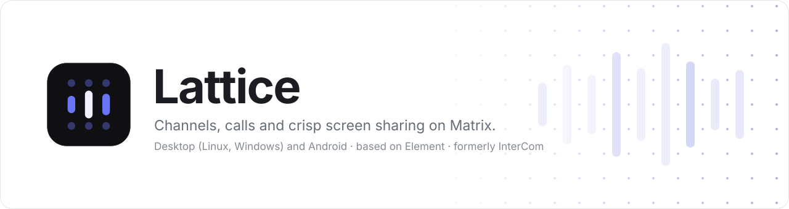
  </picture>
</p>

<p align="center">
  <a href="https://github.com/c4g7-dev/InterCom/releases/latest"></a>
  <a href="https://github.com/c4g7-dev/InterCom/releases?q=Android&expanded=true"></a>
  
  
  
  <a href="LICENSE"></a>
</p>

<p align="center">
  <a href="#download"><b>Download</b></a> ·
  <a href="docs/CHANGES-FROM-ELEMENT.md">What's different from Element</a> ·
  <a href="docs/UPDATES.md">Updates</a> ·
  <a href="docs/DESIGN.md">Design</a> ·
  <a href="docs/BUILDING.md">Build</a> ·
  <a href="CHANGELOG.md">Changelog</a>
</p>

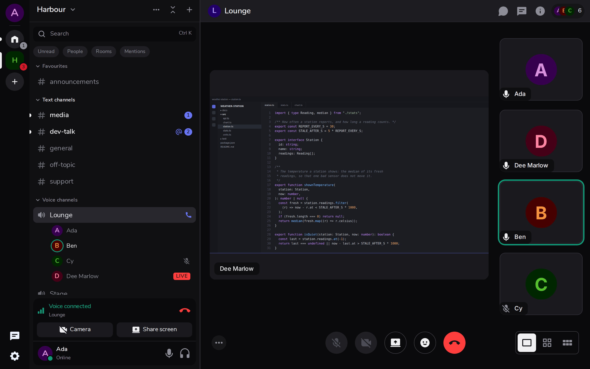

Lattice is a modified build of [Element Web / Desktop](https://github.com/element-hq/element-web),
[Element Call](https://github.com/element-hq/element-call) and
[Element X Android](https://github.com/element-hq/element-x-android). It keeps what they do and
changes how calls look, sound and behave, and how rooms are arranged. It is an independent
project, not affiliated with or endorsed by Element.

> [!NOTE]
> **Lattice was called InterCom** up to desktop 1.12.35-intercom.14. An installed InterCom
> updates itself to Lattice and keeps its profile and sign-in. Version numbers (`…-intercom.N`)
> and, for now, this repository keep the old name; it moves to `c4g7-dev/Lattice` once the
> installs out there can follow it. [Why, and what an update changes](docs/UPDATES.md#from-intercom-to-lattice).

## A look

<table>
  <tr>
    <td width="33%">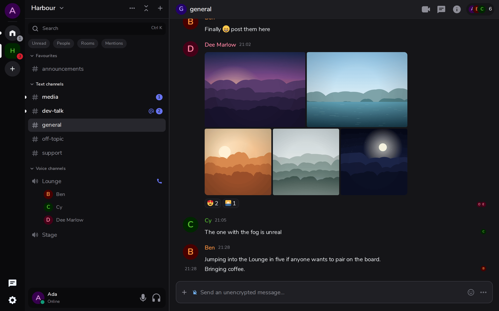</td>
    <td width="33%">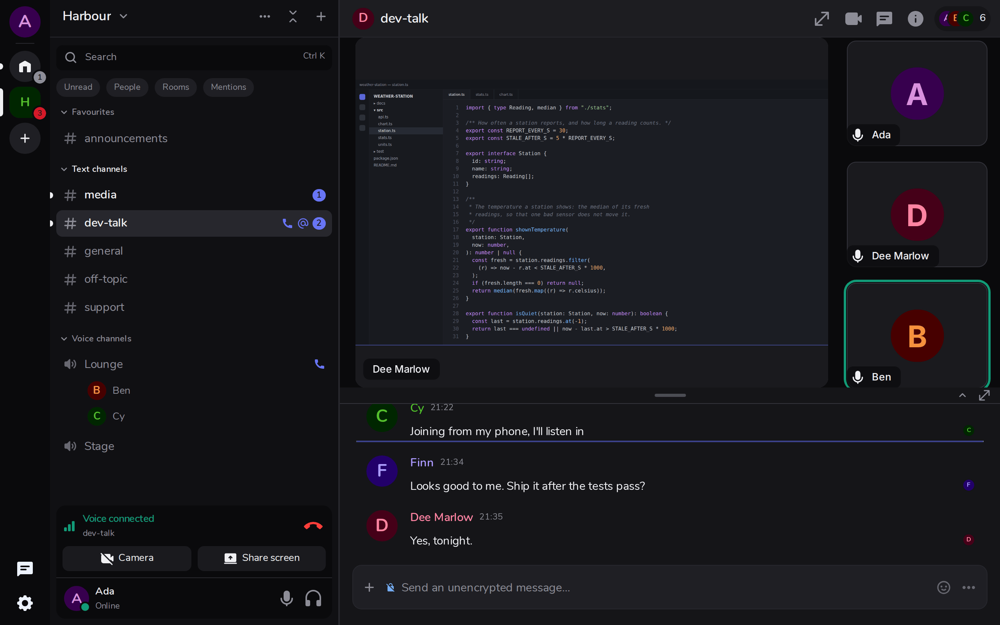</td>
    <td width="33%">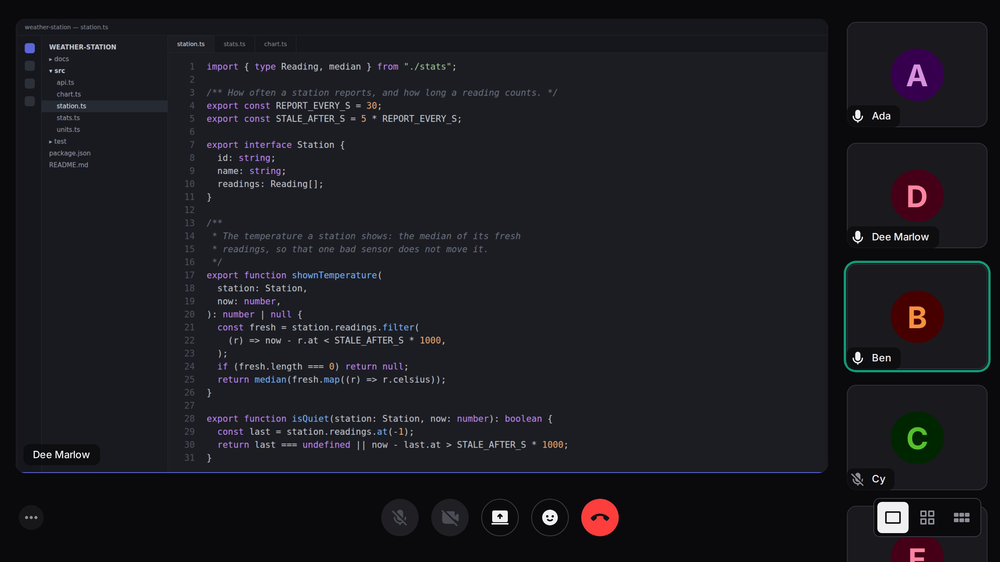</td>
  </tr>
  <tr>
    <td align="center"><sub><b>Text and voice channels</b><br>Spaces as places, the people of a call under its channel</sub></td>
    <td align="center"><sub><b>The call above the chat</b><br>A shared screen and the talk about it, together</sub></td>
    <td align="center"><sub><b>A received screen share</b><br>At the screen's own resolution, with its sound</sub></td>
  </tr>
  <tr>
    <td></td>
    <td></td>
    <td>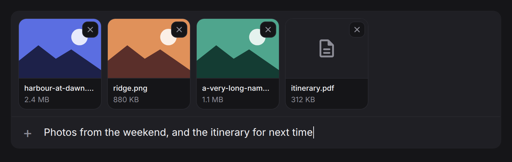</td>
  </tr>
  <tr>
    <td align="center"><sub><b>Share options and audio sources</b><br>Presets, codec, bitrate; mix what plays live</sub></td>
    <td align="center"><sub><b>Equal grid</b><br>Click a tile to focus it, pop it out, go fullscreen</sub></td>
    <td align="center"><sub><b>Attachments above the composer</b><br>Paste, drop or add; keep typing; Enter sends all</sub></td>
  </tr>
  <tr>
    <td>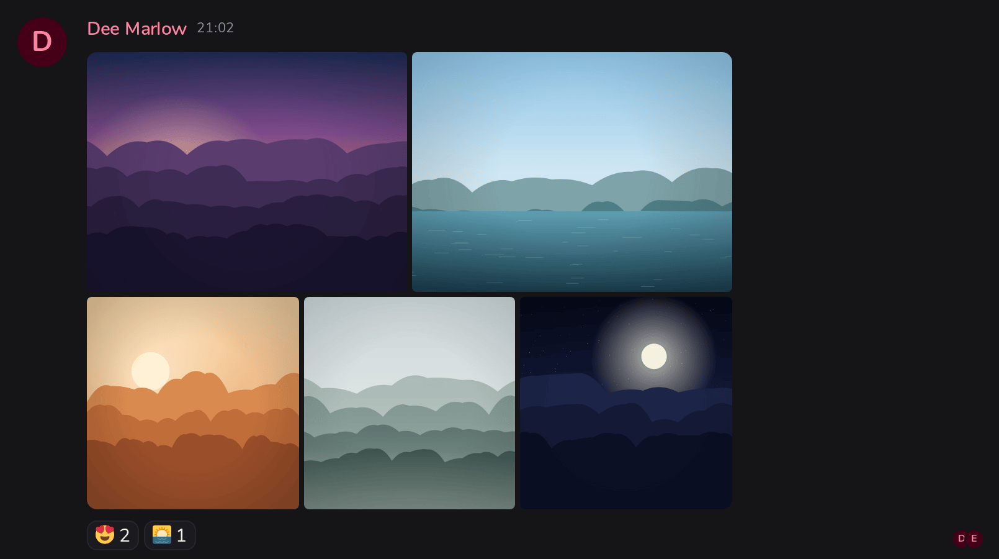</td>
    <td>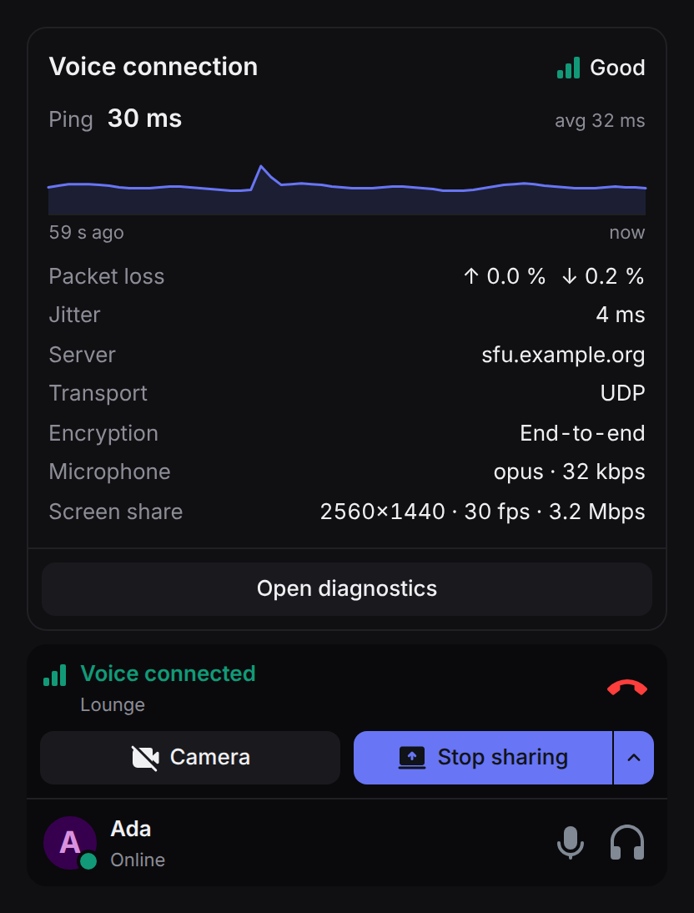</td>
    <td>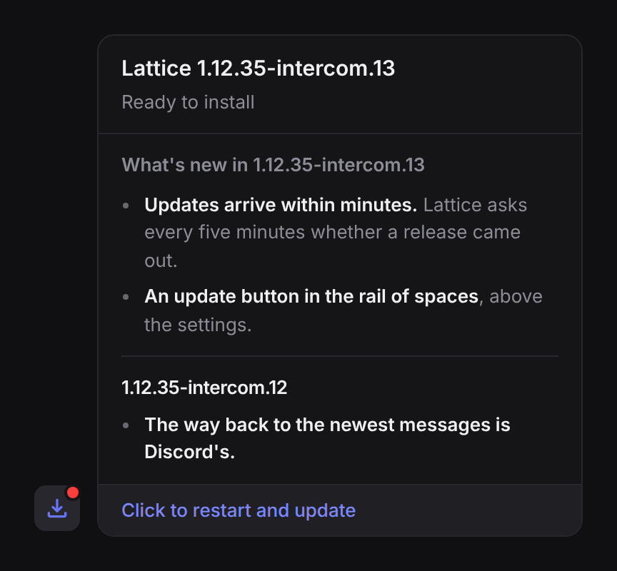</td>
  </tr>
  <tr>
    <td align="center"><sub><b>Pictures as one gallery</b><br>Sent together, shown together, with a lightbox</sub></td>
    <td align="center"><sub><b>Connection at a glance</b><br>Signal bars that open ping, loss and transport</sub></td>
    <td align="center"><sub><b>Updates itself</b><br>Within minutes of a release, with what is new</sub></td>
  </tr>
</table>

<sub>Screenshots of the real interface against a made-up homeserver: the people, rooms, pictures
and screens in them do not exist, and the call's tiles in the pictures of the whole app are a
stand-in, as there is no media server behind it. More, with every change:
[docs/CHANGES-FROM-ELEMENT.md](docs/CHANGES-FROM-ELEMENT.md).</sub>

## What you get

<details open>
<summary><b>Calls and screen share</b></summary>

- Screen share at the screen's own resolution, with presets for text, motion and low bandwidth,
  about 10 Mbit/s at 1080p and 15 Mbit/s at 1440p, codec, bitrate and frame rate to choose
- One click on the share button shares with the settings of the last time; its chevron opens
  the dialog, which like every dialog of the call uses the whole window
- The microphone stays on when you join; mute, deafen, camera and screen share on
  Ctrl+Shift+M / D / V / S and from the command line
- Signal bars that show the connection's quality and open its details (ping, loss, server,
  transport); a diagnostics overlay (Ctrl+Alt+D) and a log per run that a script turns into a
  verdict
- A private call does not end the moment the other person leaves: five minutes to stay, with a
  countdown

</details>

<details>
<summary><b>Audio</b></summary>

- Screen share audio in stereo, without voice processing
- Linux: share any PipeWire / PulseAudio output and mix several sources live; Windows: the
  system's sound
- Volume per person and per share from 0 to 200 %, with a limiter above 100 %, remembered
- Mute and deafen for the whole app, with or without a call; Lattice's own sounds, ringtone
  included, or yours

</details>

<details>
<summary><b>Channels and layout</b></summary>

- Spaces as places: text channels, voice channels with the people in them (who speaks, who is
  muted, who is live), a user panel at the bottom left
- One click drops you into a voice channel, without a lobby and without ringing anybody
- Calls in the timeline as one tile each: who is in it, how long, Join, missed or declined
- The call above the chat, an equal grid, one click to focus a tile, fullscreen and pop-out for
  every video tile

</details>

<details>
<summary><b>Messages</b></summary>

- Attachments wait above the composer: paste, drop or add pictures and files, keep typing,
  take one out again, and Enter sends them all, the pictures as one gallery with your text as
  the caption
- Pictures sent together are one gallery with a lightbox
- Pictures start uploading at once; a failed upload is tried once more
- Discord's way back: *You're viewing older messages* and **Jump to present** above the composer,
  *12 new messages since 14:32* and **Mark as read** along the top

</details>

<details>
<summary><b>App and updates</b></summary>

- Updates itself from these releases, before the window opens or with one click on the update
  button in the rail; a new release shows up within minutes, with what is new in it
- One quiet card over the user panel says that an update is ready, with *Later* and *Update*
- A near-black theme in layers and a light one; own profile, installs next to Element

<p>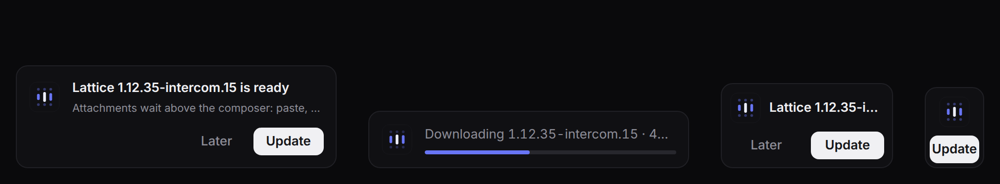</p>

</details>

<details>
<summary><b>Android</b></summary>

- Native calls with screen sharing up to 1440p at 30 fps and the phone's audio in stereo
- Shared screens with sound, a volume for every tile, an equal grid; mute and deafen that are
  kept across calls, with the app's own sounds and ringtone
- The same near-black look; pictures sent together as one gallery, several sent at once
- Updates itself and finds a release within minutes, with what is new in it; no Firebase

</details>

## Compared to Element

| | | Element | Lattice |
| :-: | --- | --- | --- |
|  | **Screen share** | 1080p at most, 5 Mbit/s, simulcast with a half-size layer | Native resolution (up to 1440p by default), presets, about 10–15 Mbit/s, egress budget; one click shares with the last settings, the dialog uses the whole window |
|  | **Share audio** (desktop) | None | Linux: PipeWire / PulseAudio outputs, mixed live; Windows: system sound |
|  | **Volume** | 0–100 % in a menu, forgotten | 0–200 % on the tile, +12 dB through a limiter, remembered |
| 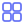 | **Layouts and windows** | Grid and spotlight | Equal grid, click to focus, fullscreen and pop-out per tile, the call above the chat |
|  | **Voice** | Video rooms with a lobby; mute per call | Voice channels: one click, no ringing, who is in them; mute and deafen for the whole app, with shortcuts |
|  | **Pictures and files** | A dialog per upload, one tile per picture | Attachments above the composer while you type; galleries with a lightbox; faster uploads |
|  | **Look** | Element's themes | Near-black layers, one accent, no shadows, a Discord-like arrangement |
|  | **Desktop app** | Squirrel updates on Windows and macOS | Self-updater on Linux and Windows that finds a release within minutes and shows what is new, call diagnostics, VA-API video on Linux |
|  | **Android** | Calls in a web view; the native path (off) shares 1280 px / 15 fps without audio | Native calls, 1440p / 30 fps share with phone audio, per-tile volume, deafen, the same look and sounds, galleries, a self-updater that finds a release within minutes |

Every change, with screenshots and the release that brought it:
[docs/CHANGES-FROM-ELEMENT.md](docs/CHANGES-FROM-ELEMENT.md).

## Download

Desktop and Android are released together, each as a release of its own with the same revision.
On the [releases page](https://github.com/c4g7-dev/InterCom/releases) their titles start with
**[Desktop]** or **[Android]**.

| | Platform | File | How |
| :-: | --- | --- | --- |
|  | **Linux** x64 | `Lattice-<version>-linux-x64.tar.gz` | Unpack and run `./intercom` (or `./lattice`) |
|  | **Windows** x64 | `Lattice-Setup-<version>-x64.exe` | Per-user installer, not code signed: SmartScreen asks once (*More info* → *Run anyway*) |
|  | **Android** arm64 | `Lattice-Android-<version>-arm64-v8a.apk`, in the newest **[Android]** release | See [docs/ANDROID.md](docs/ANDROID.md) |

<details>
<summary>Version numbers, checksums and the files named <code>InterCom-…</code></summary>

- **Version numbers.** Desktop `1.12.35-intercom.N` (based on Element Web 1.12.35), Android
  `26.11.1-intercom.N` (based on Element X 26.11.1). The part after `intercom.` is Lattice's
  revision, the same on both from 14 on (Android went from 7 to 14). It still says `intercom`:
  every install compares these numbers and finds the releases by their tags, and the installs
  from before the rename can read nothing else.
- **Checksums.** Check a download against `SHA256SUMS` from the same release with
  `sha256sum -c SHA256SUMS --ignore-missing`.
- **`InterCom-…` files.** A desktop release has each file a second time under the name from
  before the rename. They are the same files; the updater of an installed InterCom looks for
  them. Take the `Lattice-…` ones.

</details>

Both apps then update themselves: [docs/UPDATES.md](docs/UPDATES.md).

## Quick start

```sh
tar -xzf Lattice-*-linux-x64.tar.gz
cd intercom-*/
./intercom
```

Sign in with any Matrix account; choose *Edit* on the sign-in screen for your own homeserver.
Settings and sessions are kept in `~/.config/InterCom` (`%APPDATA%\InterCom` on Windows), where
they were before the rename.

- In a call: **Ctrl+Shift+M** mutes, **Ctrl+Shift+D** deafens, **Ctrl+Shift+V** toggles the
  camera, **Ctrl+Shift+S** starts or stops the screen share, **Ctrl+Alt+D** shows the
  diagnostics.
- `intercom --toggle-mute` (also `--toggle-deafen`, `--toggle-camera`, `--toggle-screenshare`,
  `--leave-call`) does the same from outside, for example from a Wayland compositor's key binding.
- `--no-hw-video` turns off hardware video, `--enable-quic` turns HTTP/3 back on, `--profile
  <name>` uses a separate profile, `--help` lists the rest.

Building from source: [docs/BUILDING.md](docs/BUILDING.md).

## Design

<p>
  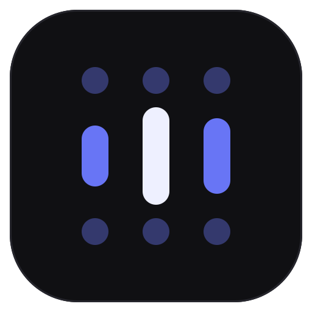
  &nbsp;
  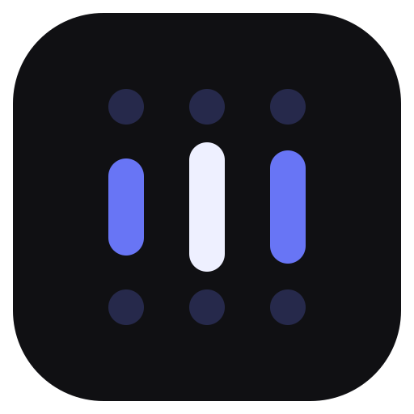
  &nbsp;
  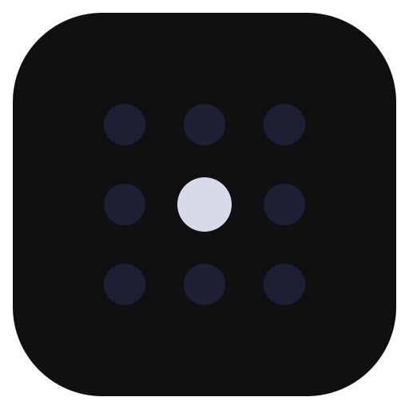
  &nbsp;
  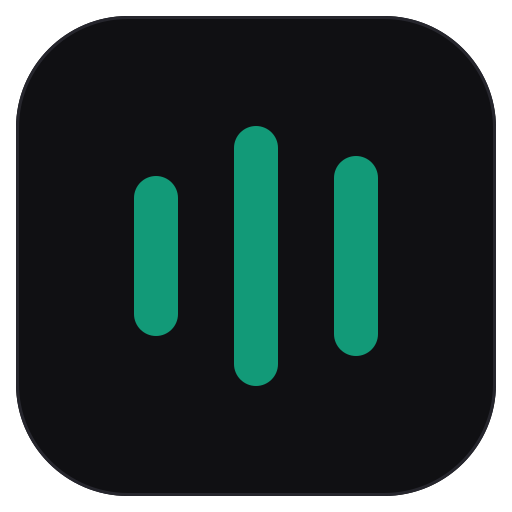
</p>

Lattice is meant to be calm to sit in and easy to read when somebody shares text. The surfaces
are near black and neutral, in three layers a step apart, with hairlines between them instead of
shadows. One accent marks what is selected or unread; green marks who speaks.

<picture>
  <source media="(prefers-color-scheme: dark)" srcset="docs/images/brand/palette-dark.svg">
  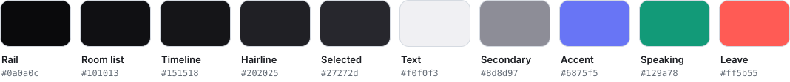
</picture>

| Lattice Dark | Lattice Light |
| --- | --- |
|  | 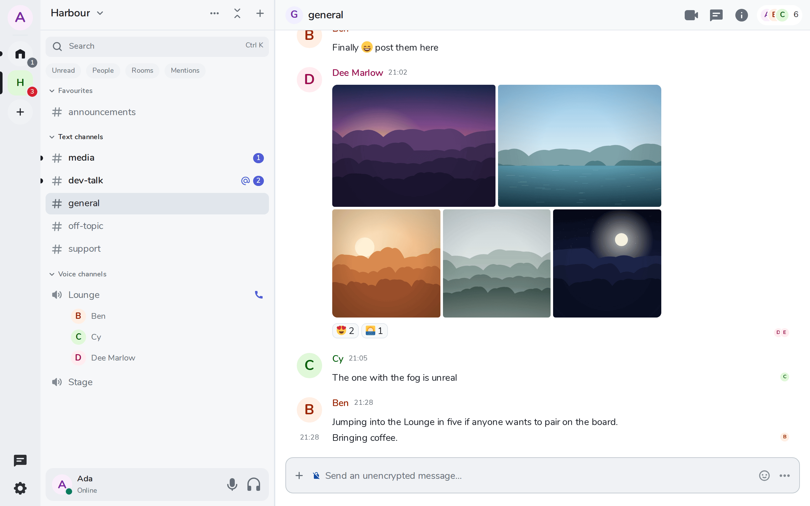 |

Surfaces are rounded, 8 px for rows and menus, 12 px for tiles, cards and the composer. The
arrangement is the one people know from Discord: a rail of spaces, text and voice channels,
grouped messages, the voice panel at the bottom left. The sounds are Lattice's own, made from
sine waves, the ringtone and the ringback too. The mark moves while the app loads, while a call
is joined and beside whoever speaks, and stands still with reduced motion. More, with the full
set of tokens: [docs/DESIGN.md](docs/DESIGN.md).

## Server requirements

Lattice talks to standard Matrix servers; nothing specific to it is needed. Calls have the
requirements of Element Call.

<details>
<summary>What calls need</summary>

- a homeserver such as [Synapse](https://github.com/element-hq/synapse) with the MatrixRTC
  settings Element Call documents, and
  [Matrix Authentication Service](https://github.com/element-hq/matrix-authentication-service)
  where the homeserver signs in through it
- a [LiveKit](https://github.com/livekit/livekit) SFU with
  [lk-jwt-service](https://github.com/element-hq/lk-jwt-service), **advertised as a LiveKit
  transport with `livekit_service_url`** (in `.well-known/matrix/client` or the homeserver's
  MatrixRTC transports). A server that advertises only an `m.livekit` transport
  with the SFU's URL alone is not supported by the Android app's native calls.

Recommended: enable VP9 and AV1 in LiveKit (`room.enabled_codecs` in `livekit.yaml`), which need
far fewer bits for shared text, and give the SFU enough uplink for the share bitrates above.

</details>

## Status and known limitations

Lattice is an independent community fork, published as is.

<details>
<summary>The list</summary>

- No hardware video encoding on Linux with NVIDIA GPUs: Chromium has no NVENC backend there.
  Decoding works with `nvidia-vaapi-driver`.
- The builds are not code signed; updates are checked against the checksums of the release they
  come from, which is no proof of who made them.
- macOS is not built.
- Sharing an output's audio on Linux needs `pactl` and PipeWire (with `pipewire-pulse`) or
  PulseAudio. See [docs/AUDIO-LINUX.md](docs/AUDIO-LINUX.md).
- Voice channels are Lattice's reading of rooms of the type `org.matrix.msc3417.call`. Other
  clients (Element, Element X, Lattice for Android) show them as ordinary rooms with a call
  button: joining works, without the channel view, the list of people or the one-click join. The
  first person to join from another client still sends Matrix's call notification.
- Attachments sent together carry Lattice's own marker (`io.intercom.gallery`); other clients
  show them as the separate messages they are.
- On Samsung Galaxy phones, **Auto Blocker** blocks installing the APK and the app's own
  updates until it is switched off (Settings → Security and privacy → Auto Blocker). See
  [docs/ANDROID.md](docs/ANDROID.md#if-the-apk-does-not-install).
- Some names did not change with the app's: the profile directory, the executable (`intercom`,
  `InterCom.exe`), the `INTERCOM_…` environment variables and the version numbers. That is on
  purpose, see [docs/UPDATES.md](docs/UPDATES.md#from-intercom-to-lattice).

</details>

Bugs in Lattice's changes belong in this repository's
[issues](https://github.com/c4g7-dev/InterCom/issues), not upstream.

## Documentation

| | |
| --- | --- |
| [What's different from Element](docs/CHANGES-FROM-ELEMENT.md) | Every change, with screenshots and the release that brought it |
| [Design](docs/DESIGN.md) | The reasoning, the mark and the tokens |
| [Updates](docs/UPDATES.md) | How both apps update themselves; from InterCom to Lattice |
| [Android](docs/ANDROID.md) | Features, push notifications, installing and troubleshooting |
| [Sharing audio on Linux](docs/AUDIO-LINUX.md) | Outputs, mixes and your own virtual devices |
| [Call diagnostics](docs/DIAGNOSTICS.md) | The log of a run and the script that reads it |
| [Building](docs/BUILDING.md) | Desktop, Android and releases |
| [Releasing](docs/RELEASING.md) | What belongs to a release besides the build |
| [Changelog](CHANGELOG.md) | Every release |

## Where the code is

This repository holds the documentation, the release tooling and links (git submodules) to the
forks that contain the app's code — GitHub's language bar above counts only this repository's
own small helper scripts (Shell, Python), which never run inside the app. Each link points to a
fork on its `intercom` branch (the branch kept its name):

| Fork | What | Language |
| --- | --- | --- |
| [lattice-element-web](https://github.com/c4g7-dev/lattice-element-web) | Desktop app, chat, channels, theme, updater | TypeScript / React |
| [lattice-element-call](https://github.com/c4g7-dev/lattice-element-call) | Calls, screen share, share audio, layouts | TypeScript / React |
| [lattice-element-x-android](https://github.com/c4g7-dev/lattice-element-x-android) | Android app | Kotlin |
| [lattice-element-call-android](https://github.com/c4g7-dev/lattice-element-call-android) | Android calls, phone screen share | Kotlin |
| [lattice-matrix-rust-rtc](https://github.com/c4g7-dev/lattice-matrix-rust-rtc) | Android call core (MatrixRTC, LiveKit) | Rust |

Media itself runs in native code: WebRTC inside Chromium on the desktop, the Rust core on
Android. Clone with `--recurse-submodules` to get everything.

## License and trademarks

Lattice is free software under the [GNU Affero General Public License v3.0](LICENSE).
It is based on Element Web, Element Desktop, Element Call and Element X Android, copyright New
Vector Ltd and Element Creations Ltd, used under AGPL-3.0; Lattice's modifications are released
under the same license. See [NOTICE](NOTICE).

"Element" is a trademark of New Vector Ltd and "Matrix" is a trademark of The Matrix.org
Foundation C.I.C. Lattice is not an Element product and is not affiliated with, endorsed by or
supported by Element or The Matrix.org Foundation.
