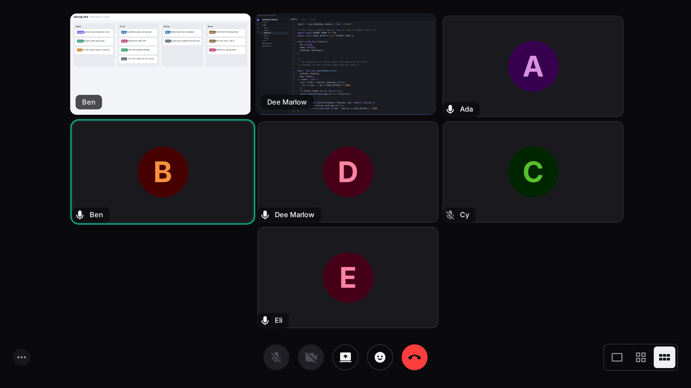

<p align="center">
  
</p>

<h1 align="center">InterCom</h1>

<p align="center">
  A Matrix client based on Element: Discord-like channels, crisp screen sharing with audio and
  better calls, for the desktop and Android.
</p>

<p align="center">
  <a href="https://github.com/c4g7-dev/InterCom/releases/latest"><b>Download</b></a> ·
  <a href="docs/CHANGES-FROM-ELEMENT.md">What's different from Element</a> ·
  <a href="docs/BUILDING.md">Build</a> ·
  <a href="CHANGELOG.md">Changelog</a>
</p>


| Text and voice channels | The call above the chat |
| --- | --- |
|  |  |
| **A received screen share** | **Equal grid** |
|  |  |
| **Screen share options and audio sources** | **Pictures as one gallery** |
|  |  |

<sub>Screenshots of the real interface against a made-up homeserver: the people, rooms, pictures
and screens in them do not exist. More, with every change: [docs/CHANGES-FROM-ELEMENT.md](docs/CHANGES-FROM-ELEMENT.md).</sub>

InterCom is a modified build of [Element Web / Desktop](https://github.com/element-hq/element-web),
[Element Call](https://github.com/element-hq/element-call) and
[Element X Android](https://github.com/element-hq/element-x-android). It keeps what they do and
changes how calls look, sound and behave, and how rooms are arranged. It is an independent
project, not affiliated with or endorsed by Element.

## Highlights

**Calls & screen share**
- Screen share at the screen's own resolution, with presets for text, motion and low bandwidth,
  about 10 Mbit/s at 1080p and 15 Mbit/s at 1440p, codec, bitrate and frame rate to choose
- The microphone stays on when you join; mute, deafen and camera on Ctrl+Shift+M / D / V and
  from the command line
- A diagnostics overlay (Ctrl+Alt+D) and a log per run that a script turns into a verdict

**Audio**
- Screen share audio in stereo, without voice processing
- Linux: share any PipeWire / PulseAudio output and mix several sources live; Windows: the
  system's sound
- Volume per person and per share from 0 to 200 %, with a limiter above 100 %, remembered
- Mute and deafen for the whole app, with or without a call; InterCom's own sounds, or yours

**Channels & layout**
- Spaces as places: text channels, voice channels with the people in them (who speaks, who is
  muted, who is live), a user panel at the bottom left
- One click drops you into a voice channel, without a lobby and without ringing anybody
- The call above the chat, an equal grid, one click to focus a tile, fullscreen and pop-out for
  every video tile

**Messages**
- Pictures sent together are one gallery with a lightbox, sent from one dialog with a caption
- Pictures start uploading at once; a failed upload is tried once more
- Discord's way back: *You're viewing older messages* and **Jump to present** above the composer,
  *12 new messages since 14:32* and **Mark as read** along the top

**App & updates**
- Updates itself from these releases, before the window opens or with one click
- A near-black theme in layers and a light one; own profile, installs next to Element

**Android**
- Native calls with screen sharing up to 1440p at 30 fps and the phone's audio in stereo
- Shared screens with sound, a volume for every tile, an equal grid; updates itself; no Firebase

## What InterCom changes compared to Element

| | Element | InterCom |
| --- | --- | --- |
| Screen share | 1080p at most, 5 Mbit/s, simulcast with a half-size layer | Native resolution (up to 1440p by default), presets, about 10–15 Mbit/s, egress budget |
| Share audio (desktop) | None | Linux: PipeWire / PulseAudio outputs, mixed live; Windows: system sound |
| Volume | 0–100 % in a menu, forgotten | 0–200 % on the tile, +12 dB through a limiter, remembered |
| Layouts and windows | Grid and spotlight | Equal grid, click to focus, fullscreen and pop-out per tile, the call above the chat |
| Voice | Video rooms with a lobby; mute per call | Voice channels: one click, no ringing, who is in them; mute and deafen for the whole app, with shortcuts |
| Pictures | One tile per picture | Galleries with a lightbox, one dialog for several, faster uploads |
| Look | Element's themes | Near-black layers, one accent, no shadows, a Discord-like arrangement |
| Desktop app | Squirrel updates on Windows and macOS | Self-updater on Linux and Windows, call diagnostics, VA-API video on Linux |
| Android | Calls in a web view; the native path (off) shares 1280 px / 15 fps without audio | Native calls, 1440p / 30 fps share with phone audio, per-tile volume, self-updater |

Every change, with screenshots and the release that brought it:
[docs/CHANGES-FROM-ELEMENT.md](docs/CHANGES-FROM-ELEMENT.md).

## Download

From the [releases page](https://github.com/c4g7-dev/InterCom/releases/latest):

| Platform | File | |
| --- | --- | --- |
| Linux x64 | `InterCom-<version>-linux-x64.tar.gz` | Unpack and run `./intercom` |
| Windows x64 | `InterCom-Setup-<version>-x64.exe` | Per-user installer, not code signed: SmartScreen asks once (*More info* → *Run anyway*) |
| Android (arm64) | `InterCom-Android-<version>-arm64-v8a.apk` | In the newest `android-v…` release; see [docs/ANDROID.md](docs/ANDROID.md) |

Check a download against `SHA256SUMS` from the same release with
`sha256sum -c SHA256SUMS --ignore-missing`. Both apps then update themselves:
[docs/UPDATES.md](docs/UPDATES.md).

## Design

InterCom is meant to be calm to sit in and easy to read when somebody shares text. The surfaces
are near black and neutral, in three layers a step apart: the rail of spaces `#0a0a0c`, the room
list `#101013`, the timeline `#151518`, with hairlines `#202025` between them instead of shadows.
One accent, `#6875f5`, marks what is selected or unread; green marks who speaks. Surfaces are
rounded, 8 px for rows and menus, 12 px for tiles, cards and the composer. The arrangement is the
one people know from Discord: a rail of spaces, text and voice channels, grouped messages, the
voice panel at the bottom left. The sounds are InterCom's own, made from sine waves. More, with
the full set of tokens: [docs/DESIGN.md](docs/DESIGN.md).

## Quick start

```sh
tar -xzf InterCom-*-linux-x64.tar.gz
cd intercom-*/
./intercom
```

Sign in with any Matrix account; choose *Edit* on the sign-in screen for your own homeserver.
Settings and sessions are kept in `~/.config/InterCom` (`%APPDATA%\InterCom` on Windows).

- In a call: **Ctrl+Shift+M** mutes, **Ctrl+Shift+D** deafens, **Ctrl+Shift+V** toggles the
  camera, **Ctrl+Alt+D** shows the diagnostics.
- `intercom --toggle-mute` (also `--toggle-deafen`, `--toggle-camera`, `--leave-call`) does the
  same from outside, for example from a Wayland compositor's key binding.
- `--no-hw-video` turns off hardware video, `--enable-quic` turns HTTP/3 back on, `--profile
  <name>` uses a separate profile, `--help` lists the rest.

Building from source: [docs/BUILDING.md](docs/BUILDING.md).

## Server requirements

InterCom talks to standard Matrix servers; nothing InterCom-specific is needed. Calls have the
requirements of Element Call:

- a homeserver such as [Synapse](https://github.com/element-hq/synapse) with the MatrixRTC
  settings Element Call documents, and
  [Matrix Authentication Service](https://github.com/element-hq/matrix-authentication-service)
  where the homeserver signs in through it
- a [LiveKit](https://github.com/livekit/livekit) SFU with
  [lk-jwt-service](https://github.com/element-hq/lk-jwt-service), **advertised as a LiveKit
  transport with `livekit_service_url`** (in `.well-known/matrix/client` or the homeserver's
  MatrixRTC transports). A server that advertises only an `m.livekit` transport
  with the SFU's URL alone is not supported by the Android app's native calls.

Recommended: enable VP9 and AV1 in LiveKit (`room.enabled_codecs` in `livekit.yaml`), which need
far fewer bits for shared text, and give the SFU enough uplink for the share bitrates above.

## Status and known limitations

InterCom is an independent community fork, published as is.

- No hardware video encoding on Linux with NVIDIA GPUs: Chromium has no NVENC backend there.
  Decoding works with `nvidia-vaapi-driver`.
- The builds are not code signed; updates are checked against the checksums of the release they
  come from, which is no proof of who made them.
- macOS is not built.
- Sharing an output's audio on Linux needs `pactl` and PipeWire (with `pipewire-pulse`) or
  PulseAudio. See [docs/AUDIO-LINUX.md](docs/AUDIO-LINUX.md).
- Voice channels are InterCom's reading of rooms of the type `org.matrix.msc3417.call`. Other
  clients (Element, Element X, InterCom for Android) show them as ordinary rooms with a call
  button: joining works, without the channel view, the list of people or the one-click join. The
  first person to join from another client still sends Matrix's call notification.
- On Samsung Galaxy phones, **Auto Blocker** blocks installing the APK and InterCom's own
  updates until it is switched off (Settings → Security and privacy → Auto Blocker). See
  [docs/ANDROID.md](docs/ANDROID.md#if-the-apk-does-not-install).

Bugs in InterCom's changes belong in this repository's
[issues](https://github.com/c4g7-dev/InterCom/issues), not upstream.

## Documentation

- [What's different from Element](docs/CHANGES-FROM-ELEMENT.md): every change, with screenshots
- [Design](docs/DESIGN.md): the reasoning and the tokens
- [Updates](docs/UPDATES.md): how both apps update themselves
- [Android](docs/ANDROID.md): features, push notifications, installing and troubleshooting
- [Sharing audio on Linux](docs/AUDIO-LINUX.md)
- [Call diagnostics](docs/DIAGNOSTICS.md)
- [Building](docs/BUILDING.md): desktop, Android and releases
- [Changelog](CHANGELOG.md)

## License and trademarks

InterCom is free software under the [GNU Affero General Public License v3.0](LICENSE).
It is based on Element Web, Element Desktop, Element Call and Element X Android, copyright New
Vector Ltd and Element Creations Ltd, used under AGPL-3.0; InterCom's modifications are released
under the same license. See [NOTICE](NOTICE).

"Element" is a trademark of New Vector Ltd and "Matrix" is a trademark of The Matrix.org
Foundation C.I.C. InterCom is not an Element product and is not affiliated with, endorsed by or
supported by Element or The Matrix.org Foundation.
