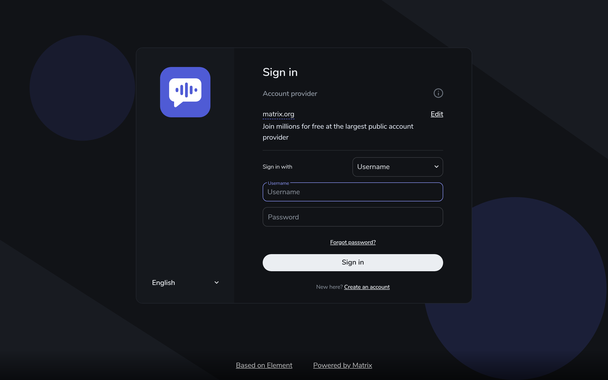
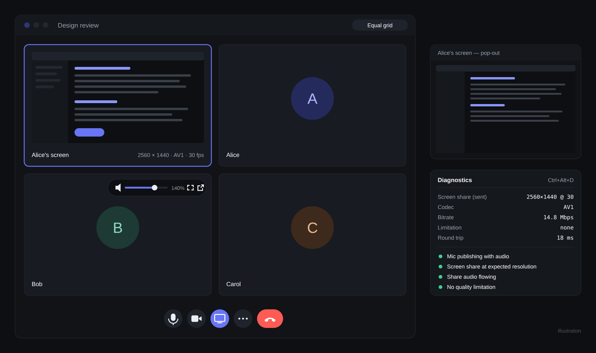
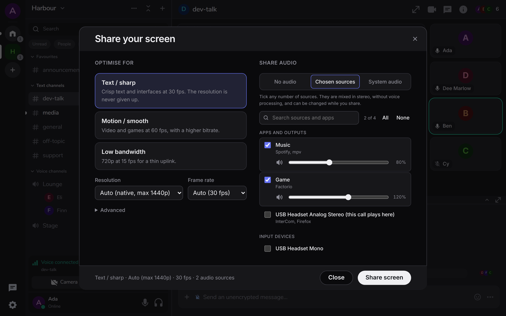

<p align="center">
  
</p>

<h1 align="center">InterCom</h1>

<p align="center">
  A Matrix desktop client based on Element, with crisp screen sharing, shared audio and better calls.
</p>

<p align="center">
  <a href="https://github.com/c4g7-dev/InterCom/releases/latest">Download</a> ·
  <a href="docs/BUILDING.md">Build</a> ·
  <a href="docs/AUDIO-LINUX.md">Audio on Linux</a> ·
  <a href="docs/DIAGNOSTICS.md">Diagnostics</a> ·
  <a href="CHANGELOG.md">Changelog</a>
</p>

| Welcome | Sign in |
| --- | --- |
|  |  |

InterCom is a modified build of [Element Web / Desktop](https://github.com/element-hq/element-web)
and [Element Call](https://github.com/element-hq/element-call). It keeps everything those do and
changes how calls look, sound and behave. It is an independent project, not affiliated with or
endorsed by Element.

## Features

**Calls and screen share**

- Screen share at native resolution, with presets for text (sharp), motion (60 fps) and low bandwidth
- High bitrates for screen share (about 10 Mbps at 1080p, 15 Mbps at 1440p) within a server egress budget
- Codec choice (VP9, AV1), custom bitrate and frame rate
- The microphone stays on when you join a call
- Mute, deafen and camera shortcuts, also from the command line for global key bindings
- Mute and deafen hold for the whole app, with or without a call, and over restarts

**Audio**

- Screen share audio in stereo, without voice processing
- Linux: share any PipeWire / PulseAudio output, and mix several sources live
- Windows: system audio with the share, without the call's own sound
- Volume per participant and per stream, 0 to 200 % (above 100 %: up to +12 dB, with a limiter)

**Layout and windows**

- The call above the room's chat, with a divider to drag, or the call alone
- Click a tile to see it large, double click for fullscreen
- Pop-out: any tile in its own window
- Equal grid: every tile the same size, screen shares included

**Messages**

- Pictures sent together are shown as one gallery, with a lightbox that steps through them
- Several pictures are sent as one batch, with an optional caption
- Pictures upload while their preview is made, not after it

**Channels**

- Voice channels (rooms that are their call) have a section of their own in the room list, with
  the people in the call listed under them: who is talking, who is muted, who is sharing
- One click joins a voice channel
- A panel under the room list with your microphone, deafen and settings buttons, and the camera,
  screen share and leave buttons of the call you are in

**App**

- Updates itself from the GitHub releases, with a status bar while it does
- Flat dark and light themes
- Hardware video decoding on Linux (VA-API)
- Built-in call diagnostics: live overlay, logs, and a summary tool
- Own profile and URL scheme: installs next to Element without sharing data with it

| Call view | Screen share options |
| --- | --- |
|  |  |

<sub>The two images above are illustrations of the call interface, not screenshots.</sub>

## Download

Get the latest build from the [releases page](https://github.com/c4g7-dev/InterCom/releases/latest).

| Platform | File | Notes |
| --- | --- | --- |
| Linux x64 | `InterCom-<version>-linux-x64.tar.gz` | Unpack and run `./intercom` |
| Windows x64 | `InterCom-Setup-<version>-x64.exe` | Per-user installer |

The Windows installer is not code signed. SmartScreen warns on first start: choose *More info*,
then *Run anyway*. Check the download against `SHA256SUMS` from the same release:

```sh
sha256sum -c SHA256SUMS --ignore-missing
```

InterCom updates itself from these releases: it looks for a new one when it starts and every six
hours, downloads it, checks it against `SHA256SUMS` and offers "Restart to update". The switch
and a "Check now" button are in Settings → InterCom. On Linux the unpacked directory is replaced
(the previous one is kept beside it as `<directory>.old`); it has to be writable for that,
otherwise the app points to the release page. If you start InterCom through a script of your
own, see "Updates" in the [desktop README](element-web/apps/desktop/intercom/README).

## Android

InterCom for Android is based on [Element X Android](https://github.com/element-hq/element-x-android).
It is released separately from the desktop app: look for the newest `android-v…` entry on the
[releases page](https://github.com/c4g7-dev/InterCom/releases) and install
`InterCom-Android-<version>-arm64-v8a.apk` (Android 7 or newer, 64-bit ARM; allow your browser or
file manager to install apps when asked). It installs next to Element X and shares no data with it. If it
does not install, see [below](#if-the-apk-does-not-install).

- Calls use the native MatrixRTC stack instead of a web view, and can **share the phone's screen**
  at its own resolution (up to 1440p on the long edge, 30 fps; 1080p, 720p and 15 fps can be chosen
  in the sheet the share button opens).
- **Share phone audio**: with the switch in that sheet on (the default, Android 10 or newer), viewers
  also hear what the phone plays: music, videos, games. Apps that forbid being recorded (many
  streaming and banking apps) and phone calls stay silent; that is Android's rule. On the desktop
  the share's volume has its own slider. It is sent for music: stereo Opus at 160 kbit/s
  (128 or 192 under "Audio quality" in the same sheet).
- **Shared screens have sound**: the audio of a screen somebody else shares is played with the
  voices, through the call's output (earpiece, speaker, headset).
- **A volume for every tile**: press and hold somebody's tile for a slider from 0 to 200 % and
  "Mute for me"; hold a shared screen's tile for the volume of its audio. Only your phone hears
  it, and it is remembered per person, as on the desktop.
- **Equal grid**: in a call, settings → Preferences → Layout → Equal grid shows every tile at the
  same size, shared screens included and uncropped, as large as the screen allows in either
  orientation. Double-tap a tile to fill the screen with it, as before.
- Sign-in through Matrix Authentication Service works on servers whose MAS accepts the redirect
  scheme `com.c4g7.intercom.android` for the client URI `https://c4g7.com`, which is the default
  policy. Building for another domain: see the fork's README.
- **Push notifications need a UnifiedPush distributor**, because the app contains no Google
  Firebase: install [ntfy](https://f-droid.org/packages/io.heckel.ntfy/) (or another
  [distributor](https://unifiedpush.org/users/distributors/)), open it once, then choose it in
  InterCom under Settings → Notifications → Push notification provider. The homeserver must be able to reach the distributor's
  Matrix gateway (for ntfy.sh: `https://ntfy.sh/_matrix/push/v1/notify`) over HTTPS. Without a
  distributor, messages arrive only while the app is open.
- No analytics and no bug report upload.
- **Updates itself** (from 26.11.1-intercom.4): the app looks for a newer release when it starts
  and every twelve hours, on Wi-Fi unless you allow mobile data, and offers it in a notification
  and under Settings → InterCom updates. It downloads the APK, checks its SHA-256 and that it
  is signed with the key of the installed app, and hands it to Android's installer. The first
  update needs you once: Android asks to allow InterCom to install apps, and may ask to
  confirm. On Android 12 or newer, later updates install without a question. The app closes
  while it is replaced, and a notification says when it is done. Looking for updates can be
  switched off in the same place; it is a request to GitHub for this repository's releases.
- Every release is signed with the same key, so a newer APK also installs over the old one by
  hand.

### If the APK does not install

Android's "App not installed" does not say why. The usual reasons, most likely first:

- **A 32-bit phone.** The APK is for 64-bit ARM (arm64-v8a) only. Some inexpensive phones run
  a 32-bit Android on a 64-bit processor; an app such as "Device Info HW" shows "Supported
  ABIs", which must include `arm64-v8a`. There is no build for other processors.
- **Too little free storage.** The APK is about 125 MB and Android needs room for a copy of it
  and for the installed app: keep about 500 MB free.
- **An incomplete download.** Compare the file with `SHA256SUMS` of the release, or download
  it again; a file cut short installs as "package appears to be invalid" or not at all.
- **Play Protect or Advanced Protection.** Play Protect can block or silently stop the
  installation of an app it does not know: in the Play Store, tap your picture → Play Protect
  → settings, and try with "Scan apps with Play Protect" off, or choose "Install anyway" when
  it asks. With Google's Advanced Protection on (Android 16), or on a phone managed by an
  employer, installing from outside a store is forbidden altogether.
- **The app that opens the APK may not install apps.** Allow it when asked ("Install unknown
  apps"), or open the APK from the Files app instead of the browser.
- **Another build of InterCom is installed**, signed with another key (one you built
  yourself, for instance): uninstall it first. Element X itself is not in the way; InterCom
  has its own package name, `com.c4g7.intercom.android`.
- **A newer InterCom is installed.** Android does not install an older version over a newer
  one.

To read the reason itself, install from a computer with
[adb](https://developer.android.com/tools/adb) (USB debugging on, under the developer options):

```sh
adb install -r InterCom-Android-<version>-arm64-v8a.apk
```

It answers with the installer's code, for instance `INSTALL_FAILED_NO_MATCHING_ABIS` (32-bit
phone), `INSTALL_FAILED_INSUFFICIENT_STORAGE`, `INSTALL_FAILED_UPDATE_INCOMPATIBLE` (another
key), `INSTALL_FAILED_VERSION_DOWNGRADE` or `INSTALL_PARSE_FAILED_NO_CERTIFICATES`. Please put
that line, the phone and its Android version into an
[issue](https://github.com/c4g7-dev/InterCom/issues).

The source is the fork [intercom-element-x-android](https://github.com/c4g7-dev/intercom-element-x-android)
with the call library fork
[intercom-element-call-android](https://github.com/c4g7-dev/intercom-element-call-android) and the
RTC core fork [intercom-matrix-rust-rtc](https://github.com/c4g7-dev/intercom-matrix-rust-rtc), all
on branch `intercom` and included here as the submodules `element-x-android`,
`element-call-android` and `matrix-rust-rtc`. Building is described in
[docs/BUILDING.md](docs/BUILDING.md#android).

## Quick start

```sh
tar -xzf InterCom-*-linux-x64.tar.gz
cd intercom-*/
./intercom
```

Sign in with any Matrix account. The default homeserver is matrix.org; choose *Edit* on the
sign-in screen to use your own. Settings and sessions are stored in `~/.config/InterCom`
(`%APPDATA%\InterCom` on Windows).

HTTP/3 is off by default, because uploads stall with it behind some proxies; `--enable-quic` turns
it on. Useful options: `--no-hw-video` turns off hardware video, `--profile <name>` uses a separate
profile, `--help` lists the rest. In a call, Ctrl+Shift+M mutes, Ctrl+Shift+D deafens and
Ctrl+Shift+V toggles the camera; `intercom --toggle-mute` (also `--toggle-deafen`,
`--toggle-camera`, `--leave-call`) does the same from outside the window, for example from a
Wayland compositor's key binding.

## Build from source

```sh
git clone --recurse-submodules https://github.com/c4g7-dev/InterCom.git
cd InterCom
(cd element-call && pnpm install --frozen-lockfile && scripts/build-intercom-embedded.sh)
(cd element-web && pnpm install --frozen-lockfile)
element-web/apps/desktop/intercom/build.sh
./run-intercom.sh
```

Requirements, the Windows cross-build and the release process are in
[docs/BUILDING.md](docs/BUILDING.md). The source lives in two forks, included here as submodules:
[intercom-element-web](https://github.com/c4g7-dev/intercom-element-web) and
[intercom-element-call](https://github.com/c4g7-dev/intercom-element-call), branch `intercom`.

## Diagnostics

Press **Ctrl+Alt+D** in a call for live statistics of every track. Each run also writes a
JSON-lines log to `~/.config/InterCom/logs/`, which `tools/diag-summary.py` turns into a verdict
per feature:

```sh
tools/diag-summary.py ~/.config/InterCom/logs/diag-*.jsonl
```

Logs stay on your machine. See [docs/DIAGNOSTICS.md](docs/DIAGNOSTICS.md).

## Server requirements

InterCom talks to standard Matrix servers; nothing InterCom-specific is needed. Group calls have
the same requirements as Element Call:

- a homeserver such as [Synapse](https://github.com/element-hq/synapse), with the MatrixRTC
  settings Element Call documents
- [Matrix Authentication Service](https://github.com/element-hq/matrix-authentication-service)
  where the homeserver uses it for sign-in
- a [LiveKit](https://github.com/livekit/livekit) SFU with
  [lk-jwt-service](https://github.com/element-hq/lk-jwt-service), announced in the homeserver's
  `.well-known/matrix/client`

Recommended: enable VP9 and AV1 in LiveKit (`room.enabled_codecs` in `livekit.yaml`). Screen
shares of text need far fewer bits with them. Give the SFU enough uplink for the screen share
bitrates above.

## Status and known limitations

InterCom is an independent community fork, published as is.

- No hardware video encoding on Linux with NVIDIA GPUs: Chromium has no NVENC backend there, so
  calls and screen shares are encoded in software. Decoding works with `nvidia-vaapi-driver`.
- macOS is not built.
- Builds are not code signed. Updates are checked against the checksums of the release they come from, which is no proof of who made them.
- Sharing an output's audio on Linux needs `pactl` and PipeWire (with `pipewire-pulse`) or PulseAudio.

Bugs in InterCom's changes belong in this repository's issues, not upstream.

## License and trademarks

InterCom is free software under the [GNU Affero General Public License v3.0](LICENSE).
It is based on Element Web, Element Desktop, Element Call and Element X Android, copyright New Vector Ltd and
Element Creations Ltd, used under AGPL-3.0; InterCom's modifications are released under the same
license. See [NOTICE](NOTICE).

"Element" is a trademark of New Vector Ltd and "Matrix" is a trademark of The Matrix.org
Foundation C.I.C. InterCom is not an Element product and is not affiliated with, endorsed by or
supported by Element or The Matrix.org Foundation.
