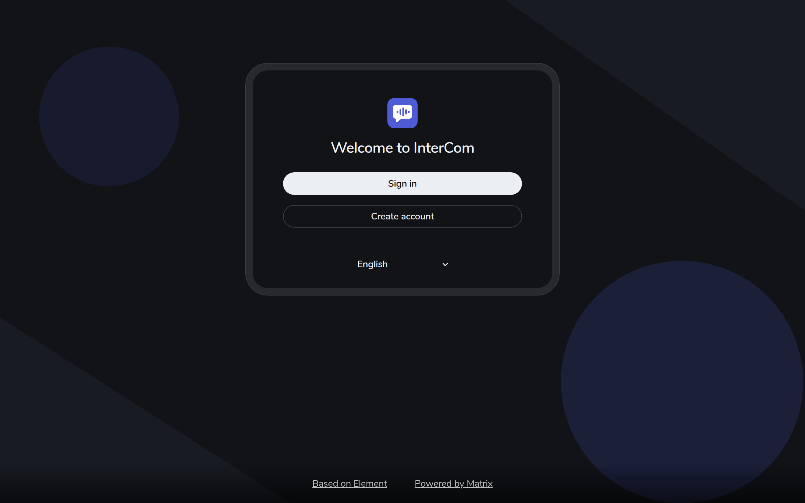

<p align="center">
  
</p>

<h1 align="center">InterCom</h1>

<p align="center">
  A Matrix desktop client based on Element, with crisp screen sharing, shared audio and better calls.
</p>

<p align="center">
  <a href="https://github.com/c4g7-dev/InterCom/releases/latest">Download</a> ·
  <a href="docs/BUILDING.md">Build</a> ·
  <a href="docs/AUDIO-LINUX.md">Audio on Linux</a> ·
  <a href="docs/DIAGNOSTICS.md">Diagnostics</a> ·
  <a href="CHANGELOG.md">Changelog</a>
</p>



InterCom is a modified build of [Element Web / Desktop](https://github.com/element-hq/element-web)
and [Element Call](https://github.com/element-hq/element-call). It keeps everything those do and
changes how calls look, sound and behave. It is an independent project, not affiliated with or
endorsed by Element.

## Features

**Calls and screen share**

- Screen share at native resolution, with presets for text (sharp), motion (60 fps) and low bandwidth
- High bitrates for screen share (about 10 Mbps at 1080p, 15 Mbps at 1440p) within a server egress budget
- Codec choice (VP9, AV1), custom bitrate and frame rate
- The microphone stays on when you join a call
- Mute, deafen and camera shortcuts, also from the command line for global key bindings

**Audio**

- Screen share audio in stereo, without voice processing
- Linux: share any PipeWire / PulseAudio output, and mix several sources live
- Windows: system audio with the share, without the call's own sound
- Volume per participant and per stream, 0 to 200 %

**Layout and windows**

- Fullscreen for every tile
- Pop-out: any tile in its own window
- Equal grid: every tile the same size, screen shares included

**App**

- Flat dark and light themes
- Hardware video decoding on Linux (VA-API)
- Built-in call diagnostics: live overlay, logs, and a summary tool
- Own profile and URL scheme: installs next to Element without sharing data with it

| Call view | Screen share options |
| --- | --- |
|  |  |

<sub>The two images above are illustrations of the call interface, not screenshots.</sub>

## Download

Get the latest build from the [releases page](https://github.com/c4g7-dev/InterCom/releases/latest).

| Platform | File | Notes |
| --- | --- | --- |
| Linux x64 | `InterCom-<version>-linux-x64.tar.gz` | Unpack and run `./intercom` |
| Windows x64 | `InterCom-Setup-<version>-x64.exe` | Per-user installer |

The Windows installer is not code signed. SmartScreen warns on first start: choose *More info*,
then *Run anyway*. Check the download against `SHA256SUMS` from the same release:

```sh
sha256sum -c SHA256SUMS --ignore-missing
```

There is no automatic update; new versions are announced on the releases page.

## Quick start

```sh
tar -xzf InterCom-*-linux-x64.tar.gz
cd intercom-*/
./intercom
```

Sign in with any Matrix account. The default homeserver is matrix.org; choose *Edit* on the
sign-in screen to use your own. Settings and sessions are stored in `~/.config/InterCom`
(`%APPDATA%\InterCom` on Windows).

Useful options: `--no-hw-video` turns off hardware video, `--profile <name>` uses a separate
profile, `--help` lists the rest. In a call, Ctrl+Shift+M mutes, Ctrl+Shift+D deafens and
Ctrl+Shift+V toggles the camera; `intercom --toggle-mute` (also `--toggle-deafen`,
`--toggle-camera`, `--leave-call`) does the same from outside the window, for example from a
Wayland compositor's key binding.

## Build from source

```sh
git clone --recurse-submodules https://github.com/c4g7-dev/InterCom.git
cd InterCom
(cd element-call && pnpm install --frozen-lockfile && scripts/build-intercom-embedded.sh)
(cd element-web && pnpm install --frozen-lockfile)
element-web/apps/desktop/intercom/build.sh
./run-intercom.sh
```

Requirements, the Windows cross-build and the release process are in
[docs/BUILDING.md](docs/BUILDING.md). The source lives in two forks, included here as submodules:
[intercom-element-web](https://github.com/c4g7-dev/intercom-element-web) and
[intercom-element-call](https://github.com/c4g7-dev/intercom-element-call), branch `intercom`.

## Diagnostics

Press **Ctrl+Alt+D** in a call for live statistics of every track. Each run also writes a
JSON-lines log to `~/.config/InterCom/logs/`, which `tools/diag-summary.py` turns into a verdict
per feature:

```sh
tools/diag-summary.py ~/.config/InterCom/logs/diag-*.jsonl
```

Logs stay on your machine. See [docs/DIAGNOSTICS.md](docs/DIAGNOSTICS.md).

## Server requirements

InterCom talks to standard Matrix servers; nothing InterCom-specific is needed. Group calls have
the same requirements as Element Call:

- a homeserver such as [Synapse](https://github.com/element-hq/synapse), with the MatrixRTC
  settings Element Call documents
- [Matrix Authentication Service](https://github.com/element-hq/matrix-authentication-service)
  where the homeserver uses it for sign-in
- a [LiveKit](https://github.com/livekit/livekit) SFU with
  [lk-jwt-service](https://github.com/element-hq/lk-jwt-service), announced in the homeserver's
  `.well-known/matrix/client`

Recommended: enable VP9 and AV1 in LiveKit (`room.enabled_codecs` in `livekit.yaml`). Screen
shares of text need far fewer bits with them. Give the SFU enough uplink for the screen share
bitrates above.

## Status and known limitations

InterCom is an independent community fork, published as is.

- No hardware video encoding on Linux with NVIDIA GPUs: Chromium has no NVENC backend there, so
  calls and screen shares are encoded in software. Decoding works with `nvidia-vaapi-driver`.
- macOS is not built.
- Builds are not code signed and do not update themselves.
- Sharing an output's audio on Linux needs `pactl` and PipeWire (with `pipewire-pulse`) or PulseAudio.

Bugs in InterCom's changes belong in this repository's issues, not upstream.

## License and trademarks

InterCom is free software under the [GNU Affero General Public License v3.0](LICENSE).
It is based on Element Web, Element Desktop and Element Call, copyright New Vector Ltd and
Element Creations Ltd, used under AGPL-3.0; InterCom's modifications are released under the same
license. See [NOTICE](NOTICE).

"Element" is a trademark of New Vector Ltd and "Matrix" is a trademark of The Matrix.org
Foundation C.I.C. InterCom is not an Element product and is not affiliated with, endorsed by or
supported by Element or The Matrix.org Foundation.
