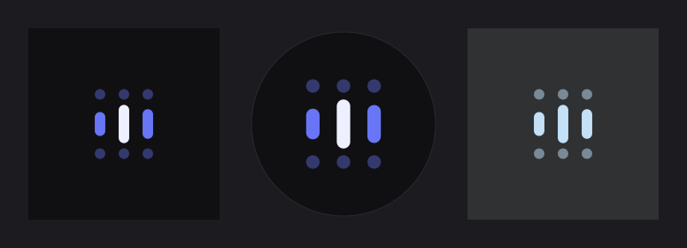
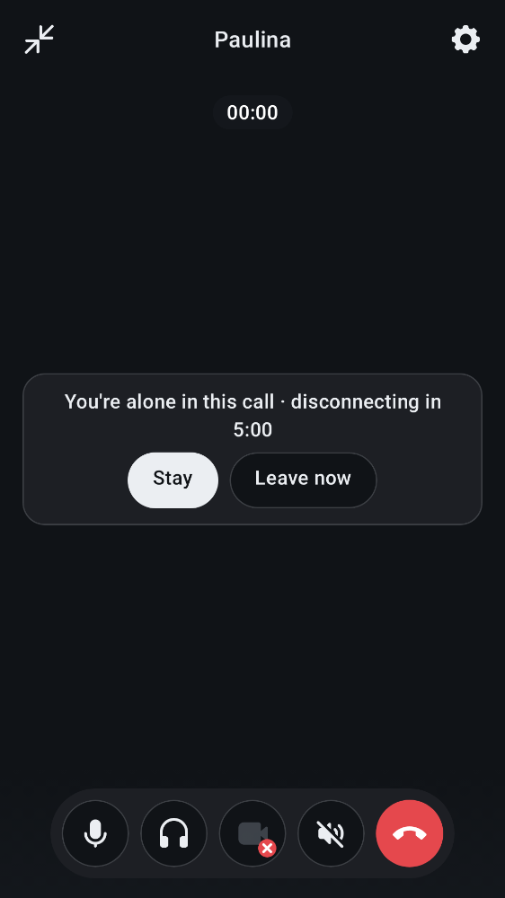
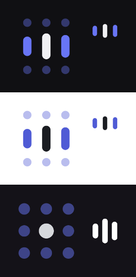
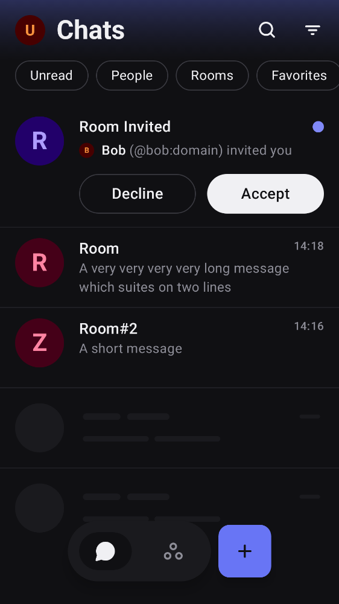
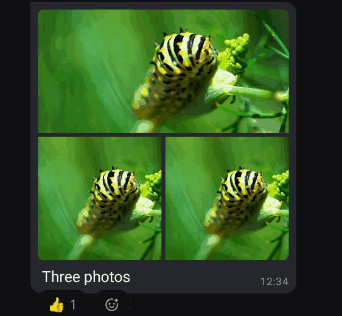
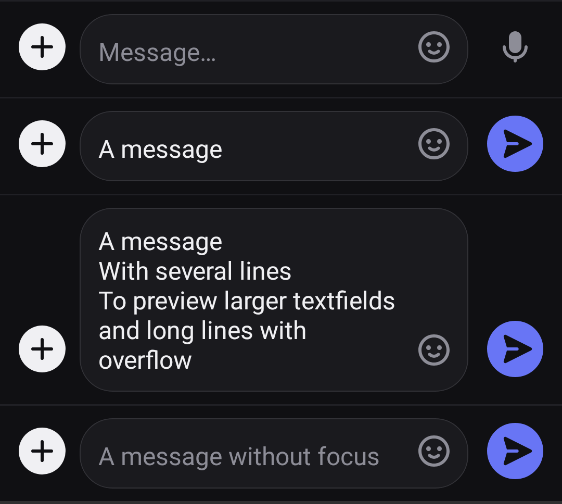
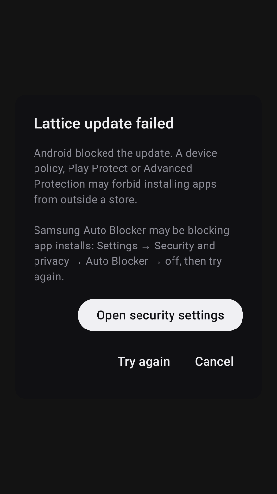

# Lattice for Android

Lattice for Android is based on [Element X Android](https://github.com/element-hq/element-x-android)
26.11.1. It is released together with the desktop app, as `android-v…` entries on the
[releases page](https://github.com/c4g7-dev/InterCom/releases), and installs next to Element X
without sharing data with it.

It was called InterCom for Android up to 26.11.1-intercom.14. [The same app under a new
name](#from-intercom-to-lattice): an update, not a new installation.

| The icon | Alone in a call | Loading |
| --- | --- | --- |
|  |  |  |

<sub>The icon is drawn from the icon set, the rest from the app's own previews, with made-up people.</sub>

## Install

Download `Lattice-Android-<version>-arm64-v8a.apk` from the newest `android-v…` release and open
it; allow your browser or file manager to install apps when Android asks. Android 7 or newer, on
64-bit ARM. Check the file against the release's `SHA256SUMS` if you like:

```sh
sha256sum -c SHA256SUMS --ignore-missing
```

After that the app [updates itself](UPDATES.md#android).

## What it does

- **Native calls.** Calls use the native MatrixRTC stack instead of a web view.
- **Screen share** at the phone's own resolution: up to 1440p on the long edge at 30 fps; 1080p,
  720p and 15 fps can be chosen in the sheet the share button opens. The choice is remembered.
- **Share phone audio** (Android 10 or newer, on by default): viewers also hear what the phone
  plays, music, videos, games, as stereo Opus at 160 kbit/s (128 or 192 under *Audio quality*).
  Apps that forbid being recorded (many streaming and banking apps) and phone calls stay silent;
  that is Android's rule. On the desktop the share's sound has its own volume slider.
- **Shared screens have sound**: the audio of a screen somebody else shares is played with the
  voices, through the call's output (earpiece, speaker, headset).
- **A volume for every tile**: press and hold a tile for a slider from 0 to 200 % and *Mute for
  me*; hold a shared screen's tile for the volume of its audio. Only your phone hears the
  difference, and it is remembered per person, as on the desktop.
- **Equal grid**: in a call, settings → Preferences → Layout → *Equal grid* shows every tile at
  the same size, shared screens included and uncropped, as large as the screen allows in either
  orientation. A double tap still fills the screen with one tile.
- **Deafen**, next to the microphone in a call: nobody is heard, voices and shared screens
  alike, and the microphone is muted with it; undeafen brings it back as it was. Mute and deafen
  are kept across calls: the next one is joined as the last was left.
- **Alone in a private call, you stay for five minutes.** When the other person leaves a call in
  a direct chat, the call goes on with "You're alone in this call · disconnecting in 4:59",
  *Stay* (which starts the time over) and *Leave now*. If they come back the countdown goes
  away; if nobody does you are disconnected and told so the next time you look at the app. Only
  in direct chats: a room's call or a voice channel is never left for you.
- **The camera button says when the camera cannot be used**: a small red badge on it when
  Android refused the permission (a tap asks again or leads to the settings) or the phone has no
  camera.
- **Lattice's own sounds**: the chimes for joining and leaving, cues for mute and deafen, the
  ringback of a call you start, and the ringtone of one that comes in (Settings →
  Notifications → *Call ringtone* also offers the phone's own). They are the desktop's.
- **Lattice's look**: the desktop's near-black surfaces, hairlines and single accent, and a
  light variant.
- **Lattice's own animations**: the icon's bars rise and fall while the app starts and a room
  loads, its ring of dots turns while a call connects, and somebody speaking has three moving
  bars beside their name. They stand still when Android's animations are turned off.
- **Pictures sent together are one gallery**, as on the desktop: a grid of up to five tiles
  with "+N", and a tap pages through them. Several pictures can be chosen at once; they are
  sent as a message each, marked as one batch, so every client shows them and Lattice shows
  them together.
- **No Firebase, no analytics, no bug report upload.**
- **Logs for calls**: warnings, errors and everything about calls are mirrored to logcat with
  access tokens and other secrets taken out, so a release build can be followed with
  `adb logcat -s InterComCall matrix-rtc InterCom`. Developer options → *Share logs* zips the
  app's logs for the share sheet; nothing is uploaded by the app.

| Lattice's look | Pictures sent together | The message field |
| --- | --- | --- |
|  |  |  |

<sub>Drawn from the app's own previews, with made-up people and text.</sub>

Voice channels of the desktop app are rooms of the type `org.matrix.msc3417.call`; the Android
app shows them as ordinary rooms with a call button. Joining works, without the channel view or
the list of people in the call.

## Push notifications

The app contains no Google Firebase, so push needs a
[UnifiedPush distributor](https://unifiedpush.org/users/distributors/):

1. Install [ntfy](https://f-droid.org/packages/io.heckel.ntfy/) (or another distributor) and open
   it once.
2. In Lattice: Settings → Notifications → *Push notification provider*, and choose it.

The homeserver must reach the distributor's Matrix gateway over HTTPS (for ntfy.sh:
`https://ntfy.sh/_matrix/push/v1/notify`). Without a distributor, messages arrive only while the
app is open.

## Sign-in

Sign-in through Matrix Authentication Service works on servers whose MAS accepts the redirect
scheme `com.c4g7.intercom.android` for the client URI `https://c4g7.com`, which is MAS's default
policy. To build the app for another domain, see the README of the
[Android fork](https://github.com/c4g7-dev/lattice-element-x-android).

## Calls and the server

The native call path publishes on an advertised LiveKit transport that has a JWT service
(`livekit_service_url`, served by [lk-jwt-service](https://github.com/element-hq/lk-jwt-service)).
A server that advertises only an `m.livekit` transport with the SFU's URL alone (its token would
come from the homeserver's MSC4195 `get_token`, which the SDK's bindings cannot ask for) is not
supported by it: calls cannot connect. Advertise a `livekit` transport with
`livekit_service_url`, alone or next to the other.

## If the APK does not install

Android's "App not installed" does not say why. The usual reasons, most likely first:

### Samsung Auto Blocker

On Samsung Galaxy phones (One UI 6 and newer), **Auto Blocker** blocks apps from outside the
Galaxy Store and Play Store: the APK from the browser does not install, and neither do
Lattice's own updates. Turn it off under **Settings → Security and privacy → Auto Blocker**,
install, and leave it off if Lattice should keep updating itself.

From 26.11.1-intercom.14 the app says so itself when an update does not install on a Samsung
phone, with a button that opens Auto Blocker where the phone gives a way in, and the security
settings otherwise:

<p></p>

### Other reasons

- **A 32-bit phone.** The APK is for 64-bit ARM (arm64-v8a) only. Some inexpensive phones run a
  32-bit Android on a 64-bit processor; an app such as "Device Info HW" shows "Supported ABIs",
  which must include `arm64-v8a`. There is no build for other processors.
- **Too little free storage.** The APK is about 125 MB and Android needs room for a copy of it
  and for the installed app: keep about 500 MB free.
- **An incomplete download.** Compare the file with `SHA256SUMS` of the release, or download it
  again; a file cut short installs as "package appears to be invalid" or not at all.
- **Play Protect or Advanced Protection.** Play Protect can block or silently stop the
  installation of an app it does not know: in the Play Store, tap your picture → Play Protect →
  settings, and try with "Scan apps with Play Protect" off, or choose "Install anyway" when it
  asks. With Google's Advanced Protection on (Android 16), or on a phone managed by an employer,
  installing from outside a store is not allowed at all.
- **The app that opens the APK may not install apps.** Allow it when asked ("Install unknown
  apps"), or open the APK from the Files app instead of the browser.
- **Another build of Lattice or InterCom is installed**, signed with another key (one you built
  yourself, for instance): uninstall it first. Element X is not in the way; Lattice has its own
  package name, `com.c4g7.intercom.android`, the same as InterCom's, which it replaces.
- **A newer version is installed.** Android does not install an older version over a newer
  one; going back means uninstalling first, which signs the app out.

To read the reason itself, install from a computer with
[adb](https://developer.android.com/tools/adb) (USB debugging on, under the developer options):

```sh
adb install -r Lattice-Android-<version>-arm64-v8a.apk
```

It answers with the installer's code, for instance `INSTALL_FAILED_NO_MATCHING_ABIS` (32-bit
phone), `INSTALL_FAILED_INSUFFICIENT_STORAGE`, `INSTALL_FAILED_UPDATE_INCOMPATIBLE` (another
key), `INSTALL_FAILED_VERSION_DOWNGRADE` or `INSTALL_PARSE_FAILED_NO_CERTIFICATES`. Please put
that line, the phone and its Android version into an
[issue](https://github.com/c4g7-dev/InterCom/issues).

## Known limitations

- arm64-v8a only.
- A gallery made of several picture messages is its first picture for everything you do to it:
  a reaction, a reply and removing it apply to that picture. The pictures of a batch appear in
  the chat when their upload is done, not while it runs.
- A microphone that is not permitted ends the call with a way to the settings: a call without
  a microphone needs another kind of background service on Android 14, which is not done yet.
  The camera has states of its own.
- How long you stay alone in a private call (five minutes) cannot be changed on Android yet. With
  another device of your own in the same call, being alone is noticed once the call's media
  shows only your devices.
- A call joins without a "dead man's switch" (MSC4140 delayed events are not in the SDK's
  bindings): a phone that loses its connection mid-call stays listed in the call until its
  membership expires.
- A shared screen's audio is played as part of the call, so over a Bluetooth headset it is in
  the headset's call mode, mono and narrow.
- A 1440p or 1080p share at 30 fps is demanding for a phone.

## From InterCom to Lattice

26.11.1-intercom.15 is the first version called Lattice. It is an ordinary update of InterCom:

- **What changed** is what you see: the name, the icon (launcher, round, themed, and the small
  one of notifications), the splash screen, the logo of the first screens, and the texts that
  named the app.
- **What did not**: the package name `com.c4g7.intercom.android`, the signing key, the sign-in
  (the redirect scheme `com.c4g7.intercom.android` for `https://c4g7.com`), the accounts and
  everything stored. So the update installs over InterCom and you stay signed in; nothing has to
  be set up again. New sign-ins show "Lattice" as the client's name on the server. The version
  still reads `26.11.1-intercom.<n>`, and `adb logcat -s InterComCall matrix-rtc InterCom` still
  names the logs.
- **The releases** are still at `github.com/c4g7-dev/InterCom`, and each carries the APK twice,
  as `Lattice-Android-…` and as `InterCom-Android-…`. InterCom 26.11.1-intercom.14 and older
  take a release only if it has the APK under the old name, named by `android-update.json`, at
  an address below `https://github.com/c4g7-dev/InterCom/releases/download/`. GitHub answers
  for a renamed repository under its new name, which those versions would refuse, so the
  repository keeps its name until they are gone. From 26.11.1-intercom.15 on the app accepts
  both names of the APK and both `c4g7-dev/InterCom` and `c4g7-dev/Lattice`, so that the
  repository can be renamed then without cutting anybody off. More in
  [UPDATES.md](UPDATES.md#from-intercom-to-lattice).

## Source

The app is the fork [lattice-element-x-android](https://github.com/c4g7-dev/lattice-element-x-android),
with the call library fork [lattice-element-call-android](https://github.com/c4g7-dev/lattice-element-call-android)
and the RTC core fork [lattice-matrix-rust-rtc](https://github.com/c4g7-dev/lattice-matrix-rust-rtc),
all on branch `intercom` and included here as the submodules `element-x-android`,
`element-call-android` and `matrix-rust-rtc`. Building: [BUILDING.md](BUILDING.md#android).
