# What InterCom changes compared to Element

InterCom is Element Web / Desktop 1.12.35 with Element Call 0.29.0-rc.2, and Element X Android
26.11.1 with element-call-android 0.1.2 and matrix-rust-rtc 0.5.0, changed in the places listed
here. Everything else is Element as it is.

- **Element** is what the upstream release does at that version. A dash means it has nothing of
  the kind.
- **Since** is the InterCom release that brought the change: `.4` is desktop 1.12.35-intercom.4,
  `A.2` is Android 26.11.1-intercom.2. The details are in the [changelog](../CHANGELOG.md).

The screenshots were taken from the real interface against a made-up homeserver. The people,
rooms, pictures and shared screens in them do not exist.

**Contents:** [Calls & screen share](#calls--screen-share) ·
[Audio](#audio) · [Layouts & windows](#layouts--windows) ·
[Channels & voice channels](#channels--voice-channels) ·
[Messages, galleries & uploads](#messages-galleries--uploads) · [Look](#look) ·
[App, updates & diagnostics](#app-updates--diagnostics) · [Android](#android)

## Calls & screen share

| A received screen share, large | The share dialog: presets, resolution, audio sources, advanced |
| --- | --- |
| 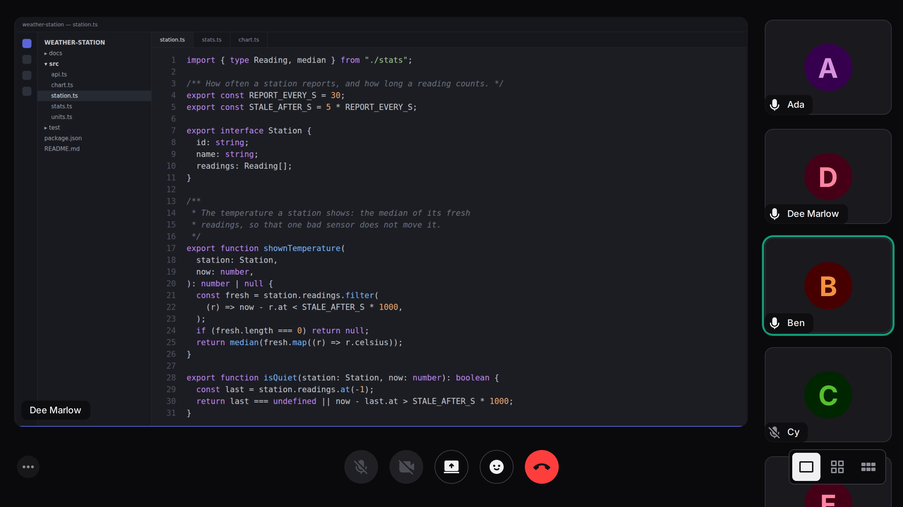 | 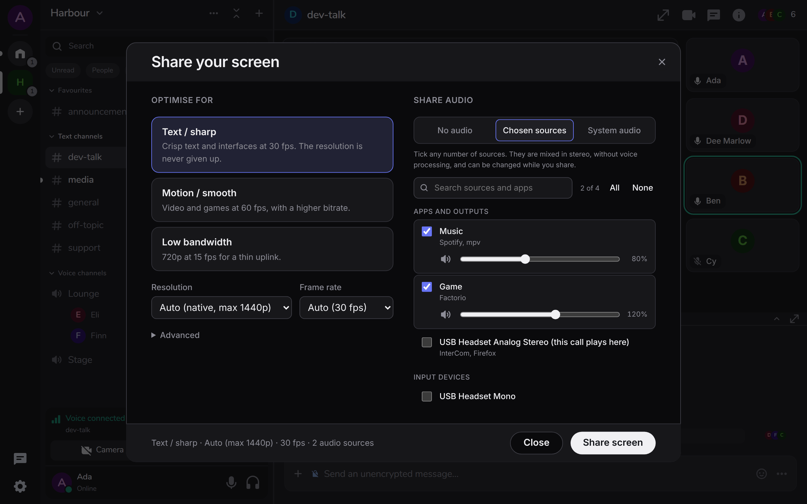 |

| Change | Element | InterCom | Since |
| --- | --- | --- | --- |
| Before a share | Straight to the system's picker. Quality only behind a developer setting, off by default | A **"Share your screen"** dialog first: *Optimise for*, *Resolution*, *Share audio from*, *Advanced*. Every choice is kept for the next share | .1 |
| Presets | — | **Text / sharp** (30 fps, resolution never given up), **Motion / smooth** (60 fps), **Low bandwidth** (720p, 15 fps) | .1 |
| Resolution | 1920 × 1080 at most | **Auto (native, max 1440p)**: the screen's own size up to 1440 lines; a larger screen is scaled down by a whole factor, so 4K is sent at 1080p. **Native (no cap)**, 1440p, 1080p | .1 |
| Encoding | 5 Mbit/s, VP8, simulcast with a half-size layer, no content hint | One layer at full size: about 10 Mbit/s at 1080p and 15 Mbit/s at 1440p. The content hint of the preset is kept for every codec. A share, a fullscreen tile and a popped-out tile ask for the best layer; video keeps flowing while the window is in the background | .1 |
| Codec, bitrate, frame rate | Only through a developer setting | *Advanced*: codec Auto (VP8), VP8, H.264, VP9 or AV1 (every viewer must be able to decode it; nothing checks that); custom bitrate up to 80 Mbit/s; custom frame rate up to 120 | .1 |
| Server egress budget | — | `server_egress_budget_mbps` (bundled: 300). A share gets at most 80 % of the budget divided by the number of viewers, followed live; below a floor the frame rate drops, not the resolution. A custom bitrate ignores the budget, with a warning | .1 |
| Camera | 720p, 1.7 Mbit/s | 1080p, 6 Mbit/s | .1 |
| Muted after joining | A failed first publication turns the microphone switch off: you show as muted | The switch stays on and publishing is tried again until it works; a microphone that drops out and comes back returns to what you chose | .1 |
| Large calls | Joins muted from eight participants on | Joins as your microphone switch says | .1 |
| Deafen | — | Nothing of the call is heard (boosted tiles and shares included), the microphone is off, a banner says so | .1 |
| Shortcuts | `m`, `v`, space and others inside the call view | In addition **Ctrl+Shift+M** (mute), **Ctrl+Shift+D** (deafen), **Ctrl+Shift+V** (camera), in the call and in the app's window (there Ctrl+Shift+D deafens only during a call); global on Windows during a call (M and D). The same from the command line: `--toggle-mute`, `--mute`, `--unmute`, `--toggle-deafen`, `--toggle-camera`, `--leave-call` | .1, .6 |
| Diagnostics | Connection statistics on tiles, behind a developer setting | An overlay (**Ctrl+Alt+D**) with live statistics of every track and checks per member, a sharpness test pattern, a PNG snapshot of a share. See [DIAGNOSTICS.md](DIAGNOSTICS.md) | .1, .3, .4 |

## Audio

The tile volume is in the [Layouts & windows](#layouts--windows) screenshot, the share audio
sources in the share dialog above.

| Change | Element | InterCom | Since |
| --- | --- | --- | --- |
| Share audio on the desktop | Element Desktop asks the system for video only: a share has no sound | **Linux:** any PipeWire / PulseAudio output, listed with the apps playing into it, plus inputs; several sources mixed live, each with 0–200 % and mute, changeable while sharing (*Share audio sources*). **Windows:** the system's sound, without the call's own where Electron supports that. See [AUDIO-LINUX.md](AUDIO-LINUX.md) | .1 |
| Share audio quality | Where a browser adds audio: mono, 48 kbit/s, silence left out | Stereo, 192 kbit/s, nothing left out, no echo cancellation, noise suppression or gain control | .1 |
| Volume per person and per share | 0–100 % in the tile's menu, forgotten after the call | **0–200 %** right on the tile, in fullscreen, in the pop-out and in the menus. 100–200 % is 0 to +12 dB through a limiter ("180% · +9.6 dB"); below 100 % on a curve the ear hears as even. Remembered per person and per share | .1, .3 |
| The system's microphone volume | WebRTC may turn it down | Never changed by a call | .1 |
| Automatic gain control | On | Off by default on the Linux desktop, where it lowers the input for every other app | .1 |
| Mute and deafen | Mute belongs to the call | **One state for the whole app**, as in Discord: works with or without a call, kept over restarts, every call is joined with it. Changed from the user panel, the call, the shortcuts, the command line and the tray | .6 |
| Sounds | Element Call's join and leave sounds | **InterCom's own**, made from sine waves: joining and leaving (you and others), mute, unmute, deafen, undeafen. One chime for several arrivals within 1.5 s; deafened you hear only your own. Your own files `join`, `leave`, `mute`, `unmute`, `deafen`, `undeafen` (.ogg, .mp3, .wav, up to 2 MB) in `<profile>/sounds/` replace them | .7, .9 |

## Layouts & windows

| Equal grid: every tile the same size, shares included | One click focuses a tile; volume to 200 %, pop-out, fullscreen |
| --- | --- |
| 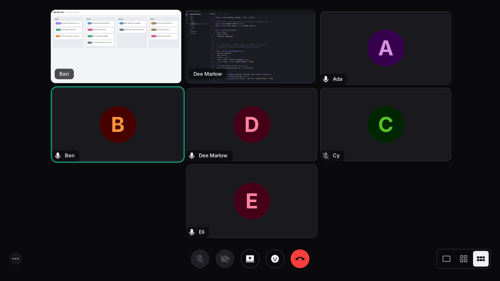 | 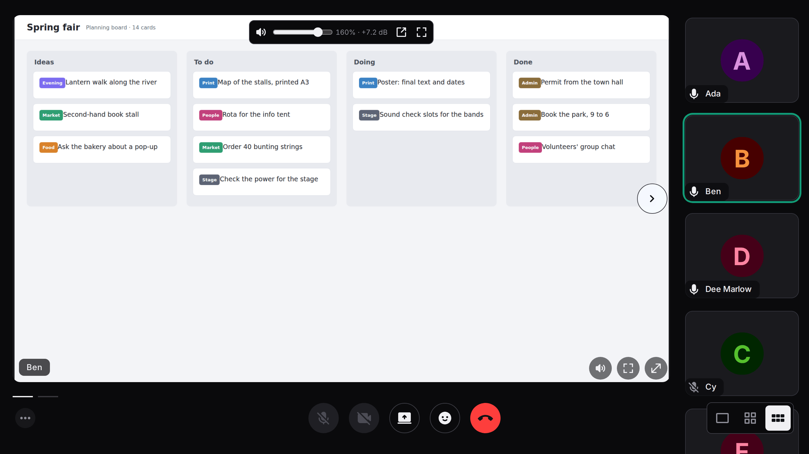 |

| The call above the chat, with a bar to resize it |
| --- |
| 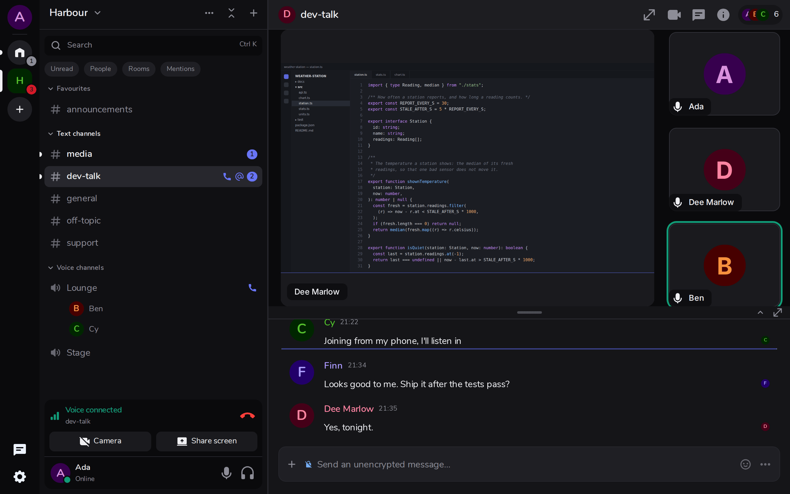 |

| Change | Element | InterCom | Since |
| --- | --- | --- | --- |
| Equal grid | Grid and Spotlight; a screen share switches the call to Spotlight | A third layout, **Equal grid**: every tile 16:9 and the same size, screen shares included and uncropped, nothing promoted. Kept for the next call | .1 |
| Focus a tile | No click action on a tile | **One click** shows a tile large with the others in a strip; another click or Escape goes back | .4 |
| Fullscreen | Only the spotlight tile | Every tile that shows video: its button or a double click | .1 |
| Pop-out | — | **Open in a separate window**: any video tile in a window of its own, with volume and fullscreen | .1 |
| Call above the chat | The call fills the room; the chat is a side panel | **The call above the timeline and composer** of an ordinary room, with a bar to drag (or arrow keys, Home, End). The chevron folds the call away; *Call only* gives it the whole room. Height and choice are remembered | .4 |
| Room list during a call | Folds away when you join | Stays | .5 |

## Channels & voice channels

| In a voice channel: who speaks, who is muted, who shares (LIVE) | A space's "+" menu |
| --- | --- |
| 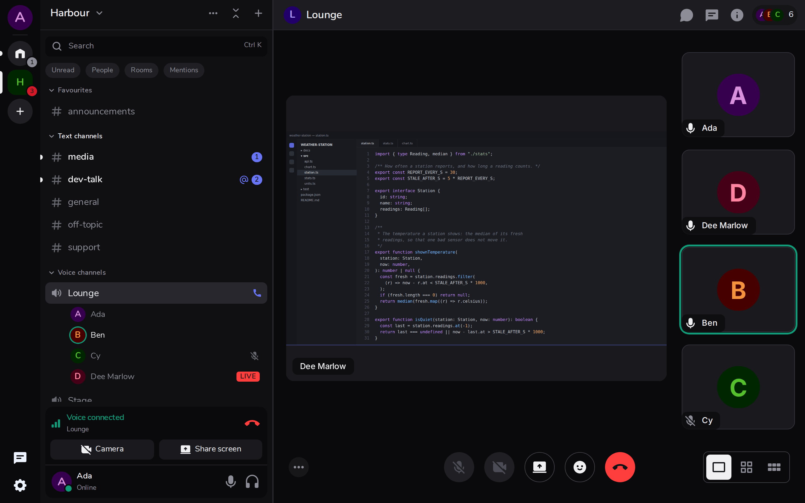 | 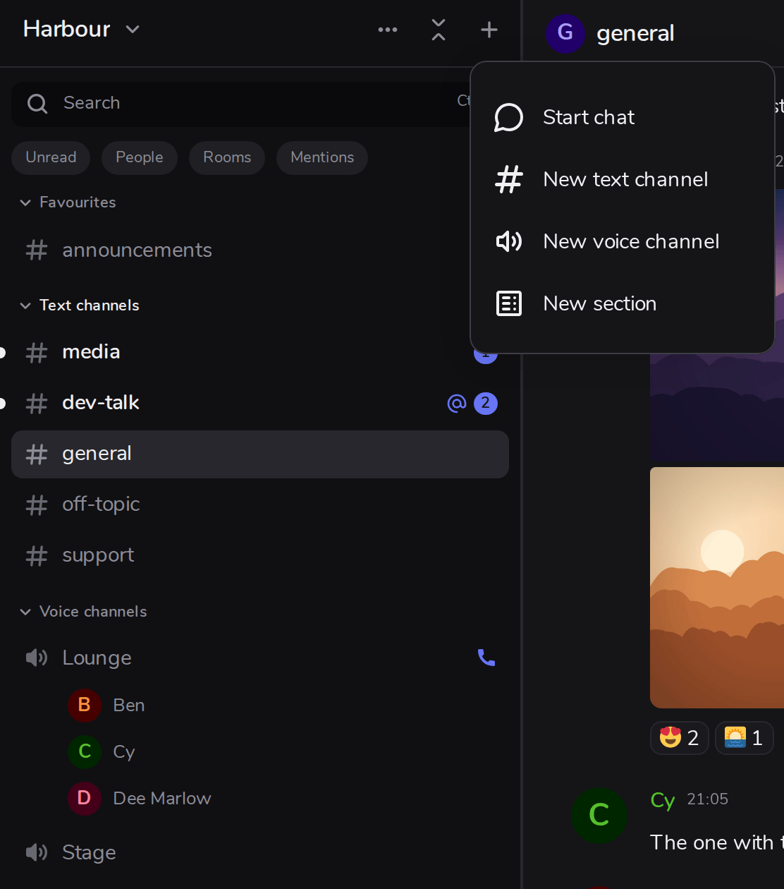 |

| Change | Element | InterCom | Since |
| --- | --- | --- | --- |
| Room list | Rooms and people | **Text channels** and **Voice channels** sections; a room has a `#`, a voice channel a speaker, a person their avatar with presence | .5, .7 |
| Voice channels | A video room opens its lobby | Rooms of the type `org.matrix.msc3417.call` (and video rooms) are voice channels: **one click joins**, without the lobby, and leaves the call you were in. Pointing at one says *Join voice* or *Connected* | .5, .7 |
| Who is in a voice channel | — | Listed under the channel, whether or not you are in it. While you are: a ring for who speaks, who is muted, **LIVE** for a screen share, your own deafen. Arrivals slide in, leavers fade out | .5, .7 |
| Ringing | The first to join sends a call notification; others get an incoming-call toast | A voice channel rings nobody: InterCom sends no notification and shows no toast for one (other clients still send it when they join first) | .7 |
| Creating | *New room*, *New video room* | In a space's "+" menu and context menu: **New text channel**, **New voice channel**, which every member of the space can join (anyone, if the space is public). Outside a space: *New voice room* | .7 |
| User panel | — | Under the room list: your avatar, name, presence, microphone and deafen. In a call, a **Voice connected** strip with the room (a way back to the call), camera, screen share and leave. A settings button with a dot appears only while an update waits | .5, .6, .9 |

## Messages, galleries & uploads

| Pictures sent together: one gallery | The lightbox steps through it |
| --- | --- |
| 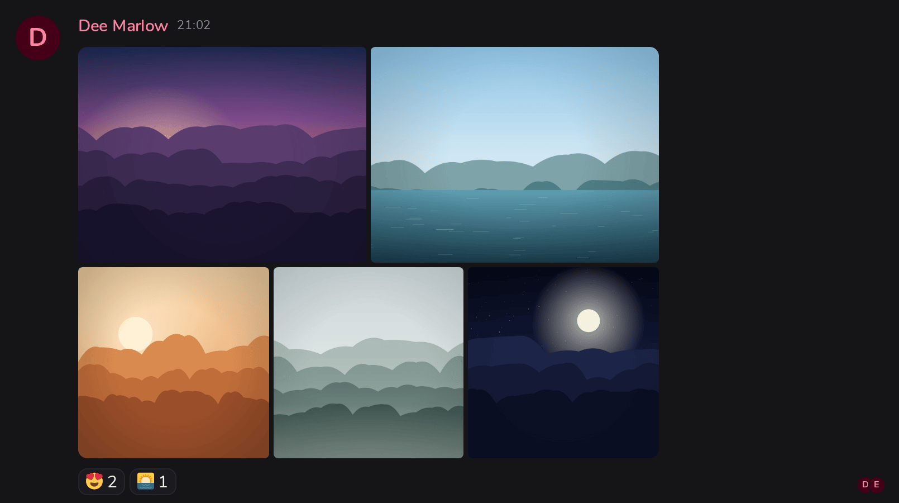 | 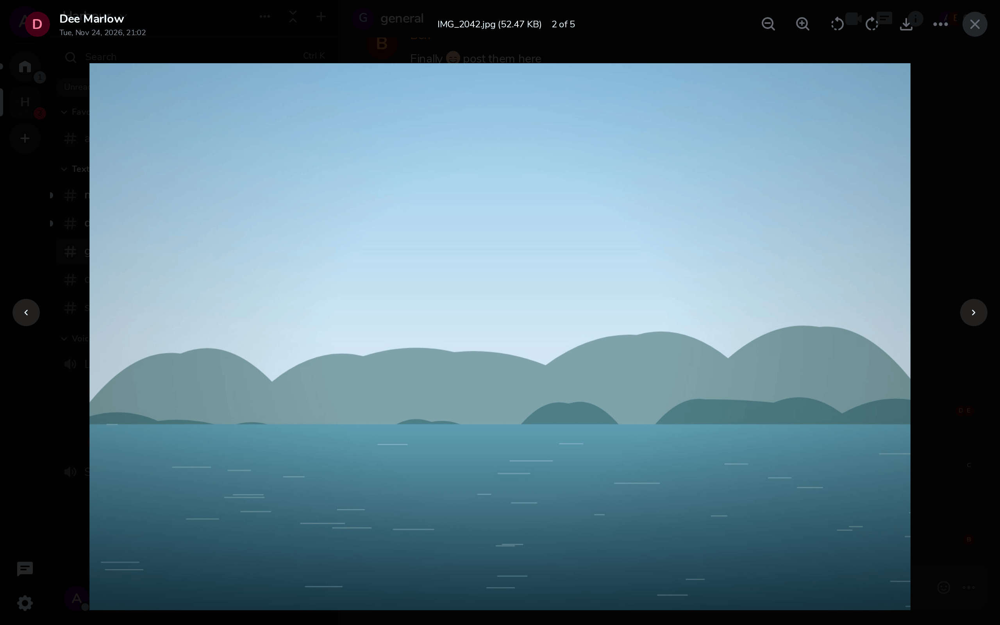 |

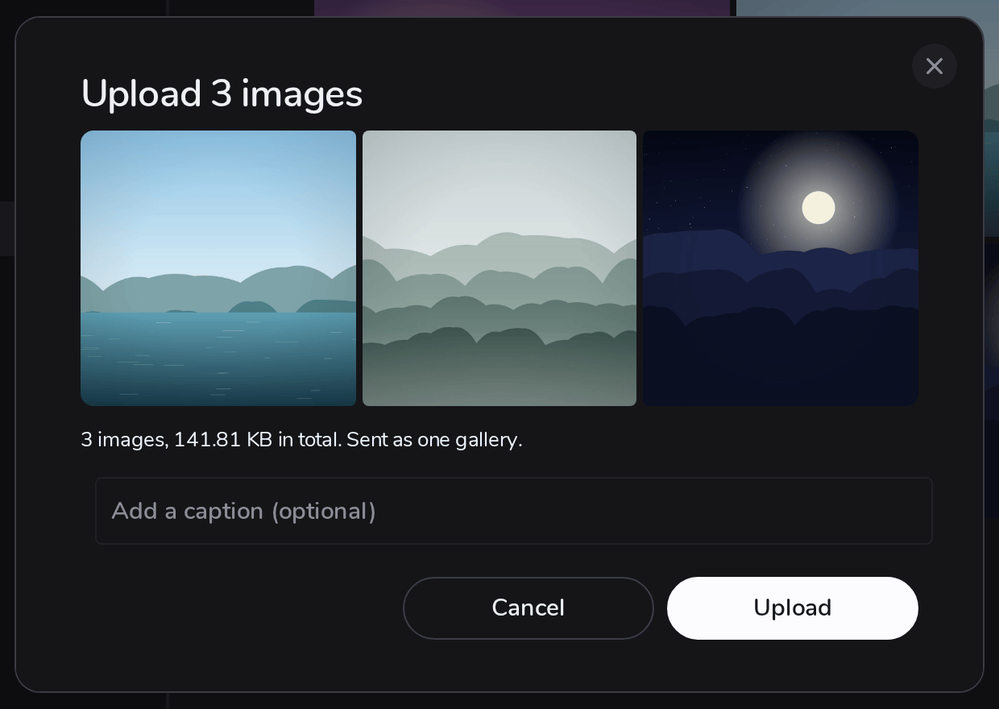 
Several pictures, one dialog

| Far back: the bar on the composer | Unread above: the bar along the top |
| --- | --- |
| 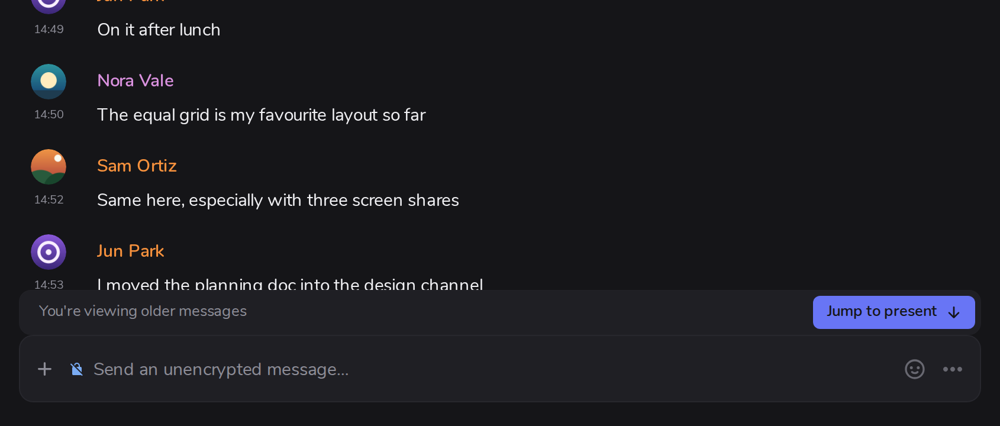 | 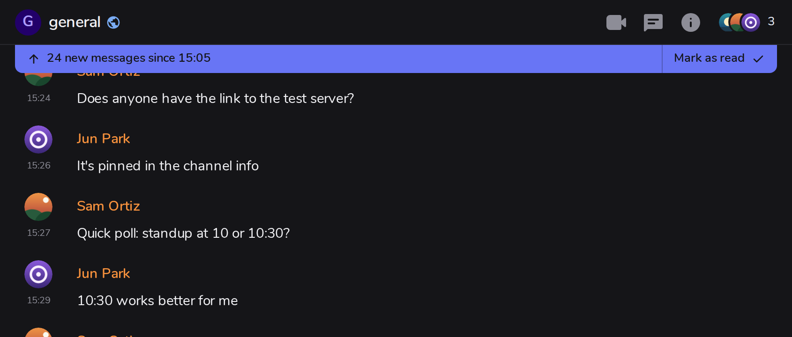 |

| Change | Element | InterCom | Since |
| --- | --- | --- | --- |
| Pictures sent together | One tile per picture | **One gallery** of cropped previews, "+N" after nine. A click opens the lightbox with previous and next (also the arrow keys) and "2 of 5". In the classic timeline and in the labs *New timeline*. Every picture stays an ordinary image message for other clients | .4, .9 |
| What forms a gallery | — | Pictures confirmed together are marked as one batch (`io.intercom.gallery`, ignored by other clients) and grouped however long their uploads took; older pictures by time (one sender, within two minutes, nothing between) | .4, .5 |
| Choosing several pictures | One confirmation per file | One dialog, **Upload N images**, showing the gallery to be, with an optional caption sent with the first | .4 |
| Sending a picture | The thumbnail is made and uploaded first, then the picture | The picture's upload starts at once and the thumbnail is made beside it; the blurhash comes from a 64 px copy; decoding is off the main thread | .4 |
| A failed upload | Fails | Tried once more after 1.5 s (no answer, 5xx, 408, 429); on servers with Matrix Authentication Service an upload renews an expiring sign-in token itself | .5, .6 |
| HTTP/3 | On | Off by default, because uploads stalled over it behind some proxies; `--enable-quic` turns it on | .5 |
| Back to the newest messages | A round button with a chevron and an unread badge | As in Discord: far back (more than one and a half screens, or the newest messages not loaded) a bar on the composer, *You're viewing older messages* or *N new messages*, with **Jump to present**; a little way up a small arrow with the count; nothing at the newest message. In the classic timeline and in the labs *New timeline* | .12 |
| Unread messages above | A round button with a dot, a small ✕ under it to mark them read | A bar along the top: *12 new messages since 14:32*, which leads to the first, and **Mark as read** | .12 |
| Escape and Shift+Page Up in the labs *New timeline* | Do nothing | Mark everything read and jump to the newest message; jump to the first unread one | .12 |
| Labs *New timeline* after a sync with a gap | Stays on the old timeline: a sent message vanishes, nothing new is shown | Follows the new live timeline | .11 |
| Account settings | Sections flash up and vanish on servers with Matrix Authentication Service | Drawn once the server has answered | .6 |

## Look

| InterCom Dark | InterCom Light |
| --- | --- |
| 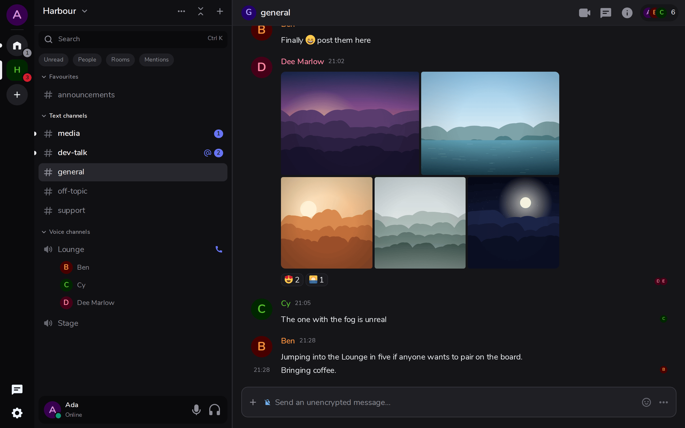 | 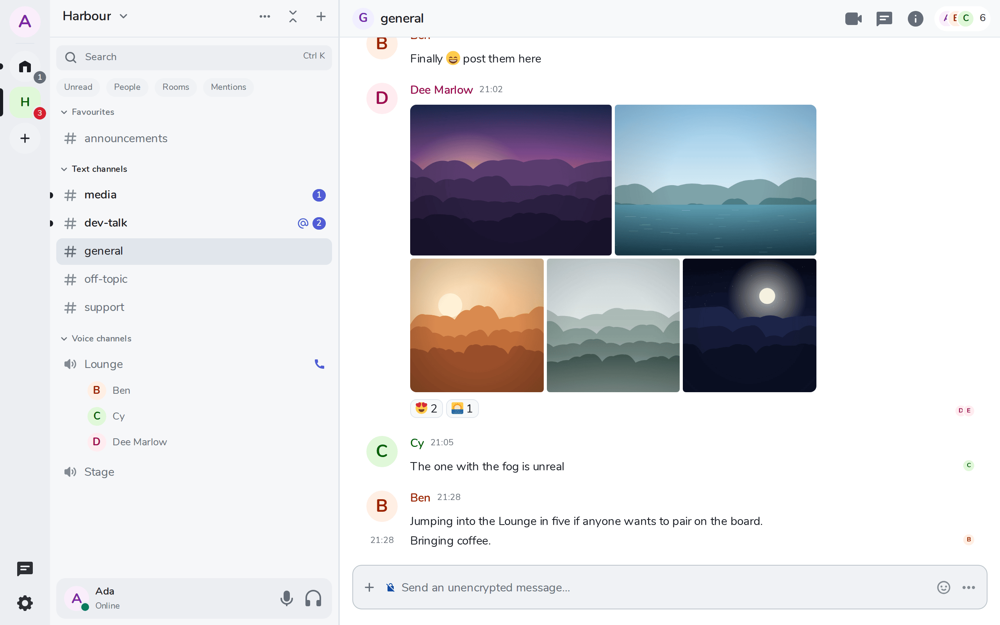 |

| Change | Element | InterCom | Since |
| --- | --- | --- | --- |
| Themes | Light and Dark, following the system | **InterCom Dark** (the default) and **InterCom Light**; following the system is off | .1, .7 |
| Surfaces | Element's palette, shadows on menus and dialogs | Near-black layers: rail `#0a0a0c`, room list `#101013`, timeline `#151518`, hairlines `#202025`, one accent `#6875f5`. No shadows; radii 6 / 8 / 12 / 16 px. The flat layer also applies to Element's own Light and Dark | .1, .7 |
| Rail of spaces | Element's space icons | Round 40 px icons that turn into rounded squares for the open space, a marker at the edge for unread and open | .7 |
| Room list | Element's rows | 34 px rows, small section labels, quiet filter chips; unread is a bold name and a marker at the edge | .7 |
| Messages | Element's layout | A sender's first message with a 40 px avatar and the time beside the name, the following ones with the time in the gutter on hover; days parted by a hairline; the actions as a small bar on the message's edge | .5, .7 |
| Composer | Element's composer | One rounded bar with the upload button (+) first | .7 |
| Dialogs | Wide translucent frame | A hairline and a 16 px radius | .7 |
| Calls | Element Call's look | The call is the darkest surface, tiles have a 12 px radius, the name is a dark pill, the ring around who speaks is green | .7 |

Why it looks like this: [DESIGN.md](DESIGN.md).

## App, updates & diagnostics

| Settings → InterCom | While an update downloads |
| --- | --- |
| 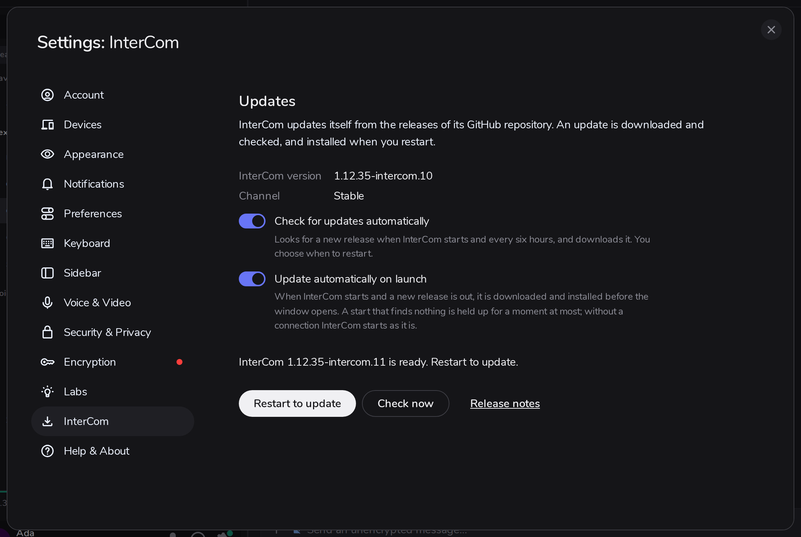 | 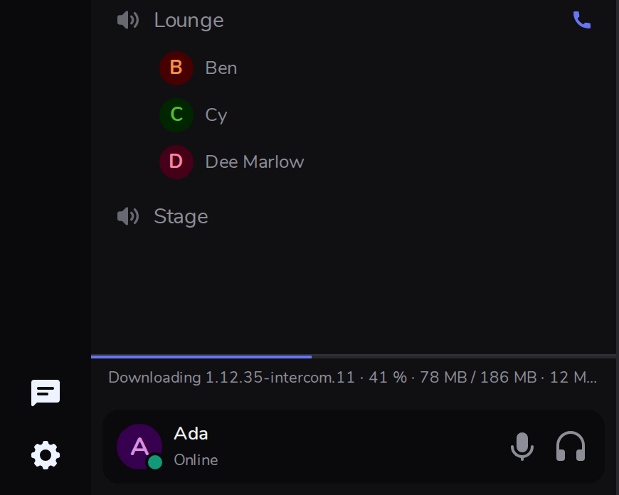 |

| Change | Element | InterCom | Since |
| --- | --- | --- | --- |
| Name and profile | Element's (`~/.config/Element`) | Own name, icon, profile directory (`~/.config/InterCom`, `%APPDATA%\InterCom`) and URL scheme: installs next to Element without sharing data with it | .1 |
| Updates | Element Desktop updates on Windows and macOS; on Linux not at all | **Updates itself** from this repository's GitHub releases, checked against `SHA256SUMS`: before the window opens, and every six hours while it runs, with a status bar and *Restart to update* (also in the tray). Linux swaps the install directory; Windows runs the installer silently. See [UPDATES.md](UPDATES.md) | .5 – .10 |
| Hardware video on Linux | Chromium's defaults | VA-API decoding, and encoding where the driver has it (Intel, AMD; not NVIDIA). `--no-hw-video` leaves it to Chromium | .1 |
| Diagnostics log | Logs for bug reports | A JSON-lines log per run in `<profile>/logs/` (200 MB at most), *Open diagnostics folder* in the Help menu and the tray, and `tools/diag-summary.py`, which turns logs into a verdict per feature. Nothing is uploaded | .1 |
| Command line | `--profile`, `--hidden`, `--no-update` | Also the call shortcuts above, `--no-hw-video`, `--hw-video-zero-copy`, `--enable-quic`, `--no-global-shortcuts`, `--global-shortcuts-portal`; `--no-update` stops InterCom's updater too | .1 – .6 |
| Smaller things | | The window is dark while it loads; the Labs tab is shown; on Wayland only one screen picker opens at a time; on Windows a click on the tray icon hides the window | .1 |

## Android

There are no screenshots of the Android app here yet.

| Change | Element X | InterCom for Android | Since |
| --- | --- | --- | --- |
| The app | Element X | Own name, icon and package (`com.c4g7.intercom.android`): installs next to Element X. No analytics, no bug report upload | A.1 |
| Calls | Element Call in a web view; native calls and screen sharing off | **Native MatrixRTC calls**, with screen sharing | A.1 |
| Screen share | 1280 px on the long edge, 15 fps, simulcast, no sound | Up to **1440p at 30 fps**, one layer of up to 10 Mbit/s; 1080p, 720p and 15 fps can be chosen | A.2 |
| Phone audio | — | **Share phone audio** (Android 10 or newer): what the phone plays, in stereo Opus at 160 kbit/s (128 or 192 under *Audio quality*). Apps that forbid recording, and phone calls, stay silent | A.2, A.3 |
| A shared screen's sound | Not played | Played in stereo with the voices, through the call's output | A.3 |
| Volume per tile | — | Press and hold a tile: **0–200 %** and *Mute for me*, per person and for their share, remembered; the desktop's curve and limiter | A.3 |
| Equal grid | — | Call settings → Preferences → Layout → **Equal grid** | A.2 |
| Push | Firebase or UnifiedPush, depending on the build | UnifiedPush only: a distributor such as ntfy is needed | A.1 |
| Updates | Through the store | **Updates itself** from the GitHub releases: looks when opened (at most every half hour), downloads on Wi-Fi unless mobile data is allowed, never during a call, checks the SHA-256 and the signing key | A.4, A.5 |
| Call transport | Native calls (off by default) take the first advertised transport | Publishes on the advertised transport that has a JWT service (`livekit_service_url`) | A.7 |
| Logs | — | Call logs mirrored to logcat without secrets (`adb logcat -s InterComCall matrix-rtc InterCom`); Developer options → *Share logs* | A.7 |

Details, installing and troubleshooting: [ANDROID.md](ANDROID.md).
