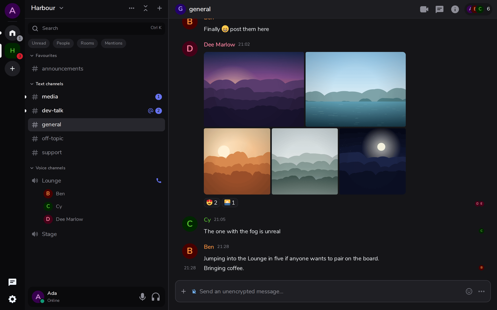
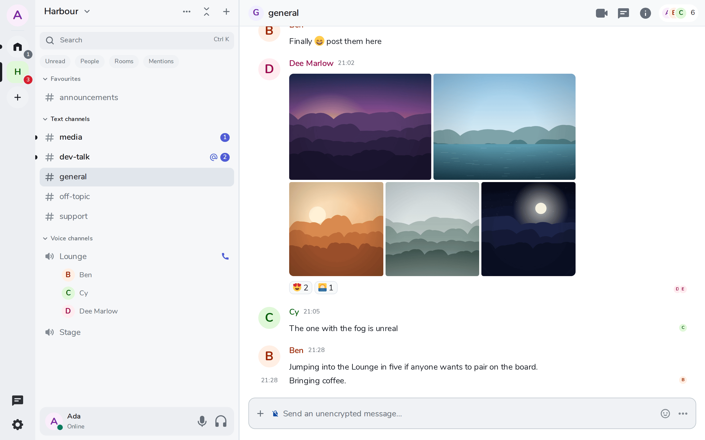

# Design

InterCom is meant to be calm to sit in for hours and easy to read when somebody shares text. The
look follows from that: dark, quiet surfaces that stay out of the way of what is on them, one
colour that means "this is active", and an arrangement people already know from Discord.

| InterCom Dark | InterCom Light |
| --- | --- |
|  |  |

## Principles

- **Content first.** Messages, pictures and shared screens are the brightest things on screen;
  the frame around them is near black and neutral. A shared code editor or document reads best
  on a surface that does not compete with it, and a near-black call does not glow around a dark
  editor.
- **Layers instead of shadows.** Depth is three surfaces a step apart, the rail darkest, the
  timeline lightest, separated by one-pixel hairlines. Nothing floats on a blur or a shadow, so
  edges stay crisp at any scale and in screenshots of screenshots.
- **One accent.** `#6875f5` marks what is selected, unread or actionable, and nothing else. Green
  means "speaking" (in the room list and on call tiles alike), red is for your own muted
  controls, "LIVE" and "leave". Everything else is grey.
- **Neutral greys.** The greys have no blue in them, so pictures and shared screens keep their
  own colours next to them.
- **Rounded, not soft.** Corners are 6 px for small controls, 8 px for rows, buttons and menus,
  12 px for cards, tiles and the composer, 16 px for dialogs.
- **Quiet motion.** People joining a voice channel slide in, leavers fade; with reduced motion
  nothing moves.

## Arrangement

InterCom keeps everything Matrix and Element do, and arranges it the way people know from
Discord:

- **A rail of spaces** on the far left: round icons that become rounded squares for the open
  space, with a marker at the edge for unread and open.
- **Text and voice channels.** A space's rooms are listed as text channels (`#`) and voice
  channels (a speaker); a conversation with one person shows their face and presence.
- **Voice channels you drop into.** One click joins, nobody is rung, and the people in the call
  are listed under the channel: who speaks, who is muted, who is live.
- **Grouped messages.** A sender's first message carries the avatar and the time; the following
  ones sit close under it, with the time in the gutter on hover. Days are parted by a hairline.
- **A user panel at the bottom left**, with your microphone and deafen, and, while you are in a
  call, the call's own controls and a way back to it.
- **The call above the chat**, so a shared screen and the conversation about it are on screen
  together.
- **Dialogs of the call over the whole window.** The call has a part of the window; what it
  asks (what to share, its settings) is laid over all of it, the app dimmed behind, drawn as
  the app's own dialogs are.
- **Buttons in two parts** where an action has settings: the button does it at once (mute,
  camera, share with the settings of the last time), the chevron beside it opens the choices.

## Sound

The sounds are InterCom's own: short chimes for joining and leaving and cues for mute and
deafen, made from sine waves by a script in each fork (`apps/desktop/intercom/gen-sounds.py` in
the web fork, `scripts/intercom-sounds.py` in the call fork). None is taken from another product.
The mute and deafen cues are low and soft, so that they are heard but do not intrude.

Joining is two soft notes a major third apart going up (C, E), leaving the same two coming down
and quieter (about -18 dBFS against -15). Each is a third of a second: the second note begins in
the tail of the first, the attacks are rounded (some 12 ms), a note is a sine with very little of
its octave, and nothing is left above 4 kHz. They are of one family with the ringtone below.

Every coming and going is heard once. Your own join and leave are played by the app, also while
you are deafened; those of the others by the call. The end of a call is one sound whichever side
hung up: the call is quiet from the moment you leave, and where it has just played somebody
else's leave (or the sound of a call that was declined or not answered) the app keeps yours back
for two seconds. A change in who is in the call has to stand for 0.6 seconds before it is a
sound, so a membership that flaps makes none; nor do your own other devices, a second device of
somebody who is already there, or what your own reconnect does to the list. Several people
arriving within 1.5 seconds are one chime.

A call that is not answered yet has two more, made by the same scripts. The ringtone of a call
coming in is four soft notes going up (G, B, D, G) and a rest, 2.4 seconds a round. The ringback
you hear while your own call rings the other side is two slower notes (A, C sharp) and a longer
rest, 3 seconds a round, and quieter. Both are warm rather than bright: a sine with a little of
the octave below and above, rounded attacks, nothing above 4 kHz, and silence at both ends of
the file so that the loop has no click. They replace Element's ring and ringback, and whatever
silenced those silences these.

Your own files can replace any of them; see the [changes list](CHANGES-FROM-ELEMENT.md#audio).
The Android app takes its copies from `element-web/apps/web/res/media/intercom/`.

## Tokens

InterCom Dark and InterCom Light are custom themes in the desktop configuration
(`element-web/apps/desktop/intercom/config.json`), on top of a flat layer of CSS shared by every
theme. The call (Element Call) takes the same values in `element-call/src/intercom.css`.

| Role | InterCom Dark | InterCom Light |
| --- | --- | --- |
| Rail of spaces | `#0a0a0c` | `#eceef2` |
| Room list | `#101013` | `#f6f7f9` |
| Timeline | `#151518` | `#ffffff` |
| Hairlines, separators | `#202025` | `#e1e6ec` |
| Hover, highlight | `#1a1a1e` | `#f3f5f8` |
| Selected, menu focus | `#27272d` | `#e9ecf1` |
| Text | `#f0f0f3` | `#1b1d22` |
| Secondary text | `#8d8d97` | `#656d77` |
| Accent | `#6875f5` | `#4f5bd5` |
| Warning, muted, leave | `#ff5b55` | `#d92d3a` |

| Call | Value |
| --- | --- |
| Call background | `#0a0a0c`, the darkest surface |
| Tile | `#1a1a1e`, 12 px radius, a one-pixel border instead of a shadow |
| Controls on a tile | 8 px radius |
| Name on a tile | a dark pill, `rgb(10 10 12 / 72%)` |
| Who speaks | a green ring, the room list's green |

| Radius | Used for |
| --- | --- |
| 6 px | small controls |
| 8 px | rows, buttons, menus |
| 12 px | cards, call tiles, the composer |
| 16 px | dialogs |

## Android

InterCom for Android has the same values as Compound's semantic colours
(`element-x-android/libraries/compound/…/theme/InterComPalette.kt`), which every component of
Element X reads: the canvas is the room list's surface (`#101013`), what is raised from it the
timeline's (`#151518`), what is pressed or selected the hover and selected greys, separators
the hairline, and Compound's accent roles the one accent. Text in the accent is a step lighter
(`#8089f7`) for a contrast of 6:1 on the dark surfaces; a unit test holds text to WCAG AA on
every surface. Material's corners are 6, 8, 12 and 16 dp.
