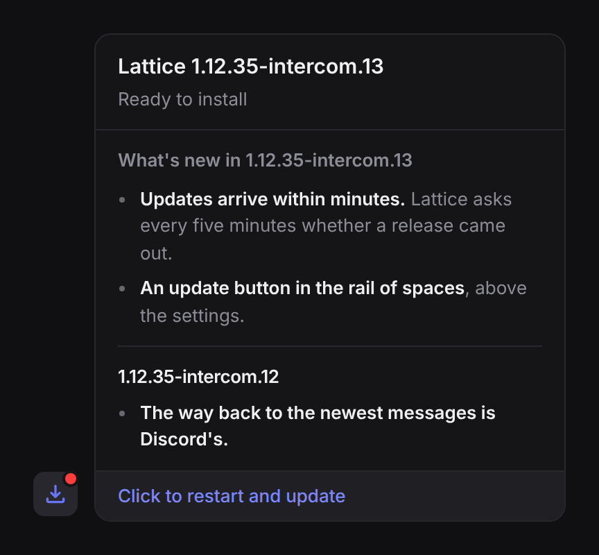
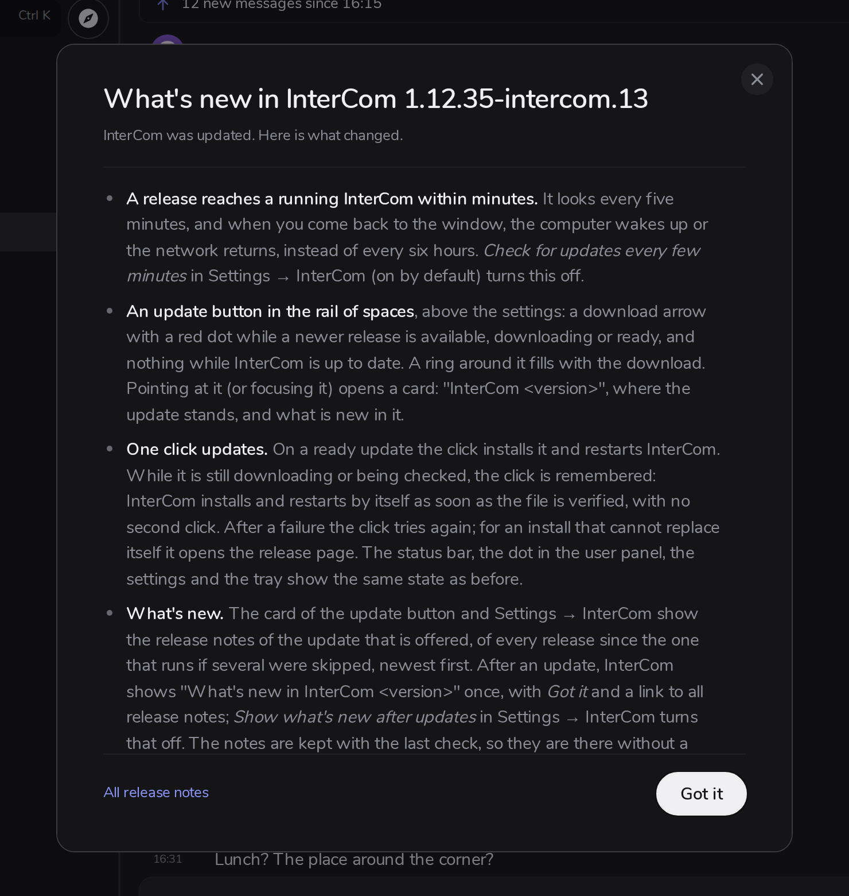
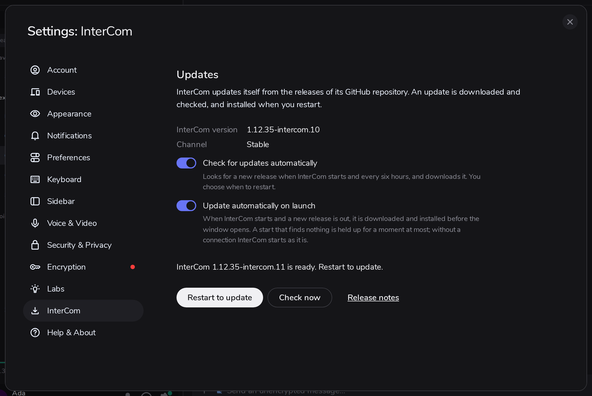
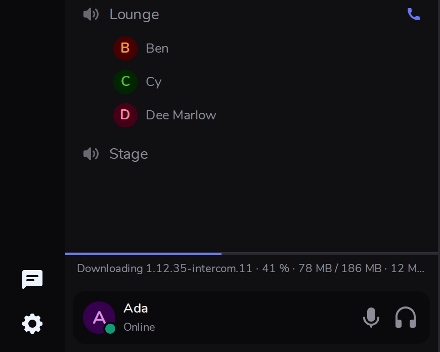
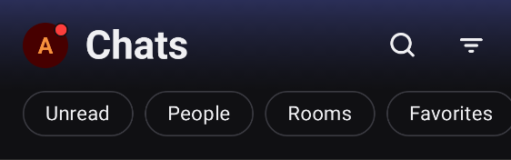
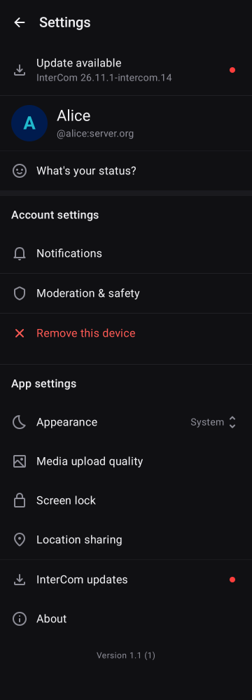
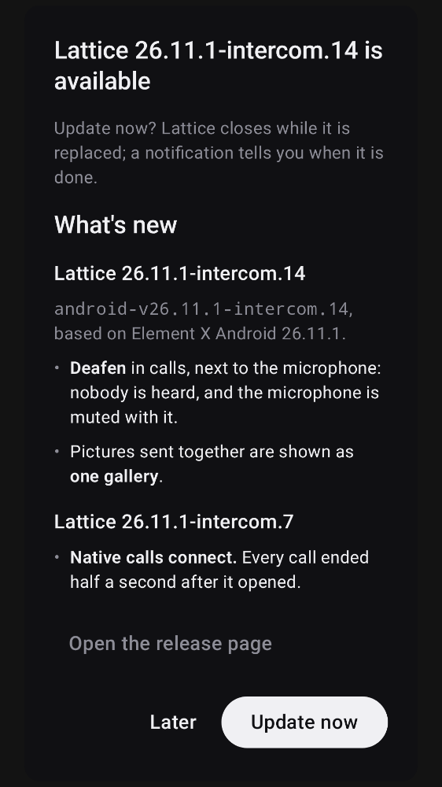

# Updates

Both apps update themselves from the [releases of this repository](https://github.com/c4g7-dev/InterCom/releases).
The desktop releases are tagged `v<version>`, the Android ones `android-v<version>`; each app
takes only its own. Drafts are never offered, pre-releases only where asked for.

The builds are not code signed. A download is checked against the `SHA256SUMS` of the release
it comes from, which catches a broken download but is no proof of who made it.

## Desktop

| The update button in the rail | After an update |
| --- | --- |
|  |  |

| Settings → InterCom | The status bar over the user panel |
| --- | --- |
|  |  |

**When it looks.** At every start, before the window opens, and 30 seconds after the start.
While it runs: every five minutes, and when you come back to the window, the computer wakes up
or the network returns (once a minute at most). Nothing pushes a release to the app; it asks,
often and cheaply:

- The frequent look asks github.com for the releases feed (`releases.atom`) with the ETag of the
  last answer. While nothing was released the answer is "304 Not Modified" without a body.
- Only when the feed changed are the releases themselves asked for, from the GitHub API: the
  last five, again with the ETag of the last answer, 8 seconds at most. This also happens every
  six hours whatever the feed says, and a minute and a half after a changed feed that showed
  nothing new (the API may answer from a copy that is a minute old).
- The API allows an address without a login 60 requests an hour, and counts unchanged ("304")
  answers too. That is why the frequent look goes to the feed, which is outside that limit: an
  hour without a release costs the API nothing.
- When GitHub refuses for too many requests (HTTP 403 or 429), nothing is asked until the time
  it names (`Retry-After`, or `x-ratelimit-reset`): a quarter of an hour where it names none,
  two hours at most. *Check now* then says how long.

With *Check for updates every few minutes* off, the releases are asked for every six hours and
nothing else is.

**At a start.** If a newer release is out, it is downloaded, checked, installed, and InterCom
comes up as the new version, with a small window saying what it is doing ("Checking for
updates…", "Downloading update · 42 %", "Installing…", "Starting…"). GitHub gets two seconds, a
start that finds nothing three at most. Offline, or when the download stalls (20 s without
progress, 5 minutes in all), InterCom starts as it is and offers the update in the app. With
`--hidden` it does the same without the window. A release that did not install at a start is
not tried at a start again; it stays behind the update button.

**While it runs.** A new release is downloaded and checked by itself. Meanwhile, and until it is
installed, the rail of spaces has an **update button** above the settings: a download arrow with
a red dot, and a ring that fills with the download. Pointing at it shows the version, where
the update stands and what is new in it. A click:

- on a ready update, installs it and starts InterCom again;
- while it downloads or is checked, is remembered: InterCom installs it and starts again by
  itself as soon as the file is verified;
- after a failure, tries again;
- for an install that cannot replace itself, opens the release page.

Nothing is installed without that click (or *Restart to update* in the status bar, the toast,
the settings or the tray menu, which do the same for a ready update). The status bar over the
user panel shows each step ("Downloading 1.12.35-intercom.11 · 42 % · 78 MB / 186 MB · 12 MB/s",
"Verifying checksum…", "Unpacking…", "… is ready" with *Restart*); a click on it lists the last
steps with their times. An error stays, with *Retry* and *Details*. A dot on the settings button
of the user panel says that an update is ready.

**What's new.** The update button's card and Settings → InterCom show the notes of the release
that is offered, and of every release between it and the one that runs, newest first. After an
update InterCom shows "What's new in InterCom" with the version once, with every release the update
brought; any way of closing it counts as seen. A first install shows nothing. The notes are the
text of the GitHub release (the section of the [changelog](../CHANGELOG.md)), kept in the profile
with the last check, so they are shown without a connection. They are drawn as text and lists:
HTML in them is not interpreted, pictures are not loaded, and links open in the browser.

**Settings → InterCom** has the version, *Check for updates automatically*, *Update
automatically on launch* and *Check for updates every few minutes* (both need the first), *Show
what's new after updates* (all on by default), *Check now*, and the notes of an update that is
offered. The switches, and the release whose notes you have seen, are kept in
`<profile>/intercom-updater.json`.

**Linux** (the unpacked `tar.gz`). The new archive is unpacked beside the install directory as
`<dir>.new`; on restart `<dir>` becomes `<dir>.old` (an older backup is deleted) and `<dir>.new`
becomes `<dir>`. To go back: quit, and rename `<dir>.old` to `<dir>`. The directory and the one
above it must be writable; where they are not (a package under `/opt`, an AppImage), nothing is
downloaded and the app points to the release page. InterCom then starts again with the options
it was started with.

If you start InterCom through a script of your own, let it export `INTERCOM_LAUNCHER` (its own
path), so that an update starts the script again rather than the program behind it, and
optionally its arguments, one per line, in `INTERCOM_LAUNCHER_ARGS`:

```sh
INTERCOM_LAUNCHER="$(readlink -f "$0")"
INTERCOM_LAUNCHER_ARGS="$(printf '%s\n' "$@")"
export INTERCOM_LAUNCHER INTERCOM_LAUNCHER_ARGS
exec /path/to/intercom/intercom "$@"
```

`run-intercom.sh` in this repository does this.

**Windows** (the per-user installer). The installer is downloaded to `%APPDATA%\InterCom\updates`,
checked, and run silently on restart; it starts InterCom again. A start with `--hidden` that
updates comes back with its window shown.

**Never updates:** a build that is not a release, an unpackaged run, and a run with
`--no-update`.

**Logged:** every check, and every look at the feed, is an `update_check` record in the
diagnostics log with what asked for it, every step of the updater an `updater` record, every
start an `update_on_launch` record. See
[DIAGNOSTICS.md](DIAGNOSTICS.md).

### Old installs

- 1.12.35-intercom.12 and older look every six hours, have no update button in the rail and
  show no release notes; they update themselves to a newer release as before.
- 1.12.35-intercom.4 and older have no updater: install a newer release by hand once.
- On Linux, 1.12.35-intercom.5 to .9 cannot install updates by themselves (their updater failed
  on the install directory): install 1.12.35-intercom.10 or newer by hand once. Windows was not
  affected.

## Android

Settings → **InterCom updates**:

- **Look for updates** (on), on any connection. While the app is on screen it asks github.com
  for the releases feed (`releases.atom`) with the ETag of the last answer: when the app is
  opened or comes back, when the network returns (once a minute at most) and every half hour.
  Only when the feed's Android releases changed are the releases themselves asked for, from the
  GitHub API, and every six hours whatever the feed says; the API allows an address without a
  login 60 requests an hour and counts unchanged answers too, the feed is outside that limit.
  In the background the releases are asked for every twelve hours. Nothing about you or your
  account is in these requests.
- **Install updates automatically** (on): a release is downloaded as soon as it is found, on
  Wi-Fi unless **Use mobile data** is on, and installed right away. It never interrupts a call:
  it waits until the call is over.
- **Offer pre-releases** (off), **Show what's new after updates** (on), **Check now**,
  **Download and install**.

| The dot on the avatar | Settings | The dialog |
| --- | --- | --- |
|  |  |  |

While a newer release is known, the avatar at the top of the chat list, which leads to the
settings, has a red dot, and the settings begin with **Update available**.

**What's new.** The dialog and *InterCom updates* show the notes of the release that is
offered and of every release between it and the one that runs, newest first. After an update
InterCom shows "What's new in InterCom" with the version once, when it first opens as the new
version; any way of closing it counts as seen, and a first install shows nothing. The notes are
the text of the GitHub releases, drawn as text and lists: HTML in them is not interpreted,
pictures are not loaded, and a link is its text.

With *Install updates automatically* off, a dialog says "InterCom <version> is available", with
*Update now*, *Later* (24 hours for that release) and *Release notes*. *Update now* downloads on
whatever connection there is, mobile data included.

What happens on the phone:

1. The first update needs you once: Android asks to allow InterCom to install apps
   ("Install unknown apps"), and may ask to confirm.
2. On Android 12 or newer, later updates install without a question; on older versions Android
   asks for one tap (from a notification when InterCom is not on screen).
3. Android closes the app while it is replaced and does not let it reopen itself: a
   notification says "InterCom was updated", and a tap on it opens the app.

An APK is installed only if it has the SHA-256 the release names and is signed with the key of
the installed app; anything else is deleted and the settings say why. When Android refuses an
update, the screen shows which of its reasons it gave and the system's own message, and what
can be done about it: free storage, a phone the release does not run on, another build being
installed, or on a Samsung phone Auto Blocker, with a button to its settings. The same hint
comes up when Android asked to confirm the update and you are back in InterCom ten seconds
later with nothing installed. The installer's status code is written to the app's log. An
automatic installation that Android refused is not tried again by itself; the release is
offered in the dialog instead.

On Samsung Galaxy phones, **Auto Blocker** stops these installs too: see
[ANDROID.md](ANDROID.md#samsung-auto-blocker).

The updater came with 26.11.1-intercom.4; the feed, the dot, the notes and the hints came with
26.11.1-intercom.14. 26.11.1-intercom.5 to .7 look when the app is opened, at most every half
hour, and read a revision of one digit only: they find 26.11.1-intercom.14 as the release
`android-v26.11.1-intercom.9`, which is the same APK under a tag they can read.
Every release is signed with the same key, so a newer APK also installs over the old one by
hand.

**From InterCom to Lattice on Android.** 26.11.1-intercom.15 is the first Android release under
the new name, and installs over InterCom as any update does: the package name
(`com.c4g7.intercom.android`), the signing key, the accounts and the data are the same. A
release carries the APK twice, as `Lattice-Android-<version>-arm64-v8a.apk` and as
`InterCom-Android-<version>-arm64-v8a.apk`, both in `SHA256SUMS`, and `android-update.json`
names the second: InterCom 26.11.1-intercom.14 and older take a release only if it has the APK
under the old name, named by that file, at an address below
`https://github.com/c4g7-dev/InterCom/releases/download/`. That last rule is why this repository
keeps its name: GitHub's API gives the files of a renamed repository under its new name, and
those versions would refuse every one of them and never find a release again. From
26.11.1-intercom.15 on the app takes the APK under either name (the one `android-update.json`
states, otherwise the first that `SHA256SUMS` lists) and files below `c4g7-dev/InterCom` or
`c4g7-dev/Lattice`, so the repository can be renamed once the installs are 26.11.1-intercom.15
or newer. Both rules are tests of the updater (`ReleaseSelectorTest`), the old versions' among
them.
